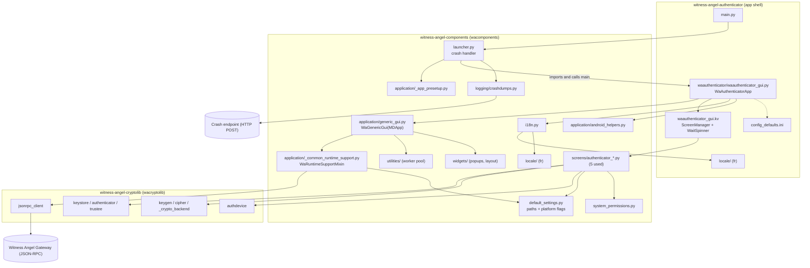

# 01 - Architecture and platform specification

Witness Angel Authenticator, version 1.5 (`witness-angel-authenticator/waauthenticator/waauthenticator_gui.py:30`, `witness-angel-authenticator/pyproject.toml:8`).

Sibling files: `02-ux-and-screens.md` (screens and flows), `03-business-logic.md` (authenticator lifecycle, revelation requests), `04-data-and-protocols.md` (keystore on-disk format, gateway JSON-RPC, crypto).

Conventions: source references are relative to the WitnessAngel workspace root. `AUTH/` = `witness-angel-authenticator/`, `COMP/` = `witness-angel-components/src/wacomponents/`, `CRYPTO/` = `witness-angel-cryptolib/src/wacryptolib/`.

Structure of this document:

- Part A (sections 1-8): functional and platform requirements, written framework-neutrally. A reimplementation must keep these.
- Part B (sections 9-12): incidental Kivy/KivyMD/buildozer implementation details. They are documented for traceability and are not requirements.
- Section 13: open issues and observations.

---

# PART A - Requirements a reimplementation must keep

## 1. Purpose, scope, actors

### 1.1 Purpose
A cross-platform app (Android, iOS, Windows, Linux, macOS) for "Key Guardians", the trusted third parties of the Witness Angel ecosystem. A guardian can (`AUTH/Readme.rst:4-12`):

- create an "authenticator": a passphrase-protected keystore holding asymmetric keypairs plus metadata;
- publish its public part to a web registry (the "gateway");
- accept or reject "revelation requests", emitted when someone needs to decrypt recordings (for example in judicial processes);
- manage, import, export and check the integrity of authenticators.

The app also fits any workflow where sensitive data is protected by remote individuals, especially shared-secret schemes (`AUTH/Readme.rst:13`).

### 1.2 Actors

| Actor | Role | Evidence |
|---|---|---|
| Key guardian | The app's user. Owns the authenticator and its passphrase, and answers requests. | `AUTH/Readme.rst:7` |
| Claimant / requestor | Another person or device that asks for decryption of recordings. It does not use this app. The app only receives their requests, through the gateway. | `AUTH/waauthenticator/waauthenticator_gui.kv:35-43` (revelation request screens) |
| Gateway | Remote web service, default `https://api.witnessangel.com/gateway/jsonrpc/`, reached over JSON-RPC. It is a registry of published authenticators and a mailbox of revelation requests. | `AUTH/waauthenticator/config_defaults.ini:5`, `COMP/application/_common_runtime_support.py:192-195` |
| Crash-report endpoint | `https://api.witnessangel.com/support/crashdumps/`, an HTTP POST target, hardcoded. | `COMP/launcher.py:69-71` |

### 1.3 Position in the ecosystem
Evidenced in code: the Witness Angel Recorder (and any "revelation station") uses published authenticators as trusted third parties to secure its recordings. The Authenticator is the guardian-side counterpart (`AUTH/Readme.rst:10`). The same `COMP` package also contains recorder, claimant and cryptainer screens (`COMP/screens/base.py:12-20`, `COMP/application/recorder_gui.py`). Those are out of scope here. The authenticator app loads only the five "AUTHENTICATOR" screens (`COMP/screens/base.py:22-27`).

## 2. Functional lifecycle requirements

### 2.1 Startup and shutdown behaviour

1. On a mobile OS, any unhandled exception at launch or while running the app is caught, an HTTP POST is sent to the crash endpoint, and the exception is re-raised (see 2.5).
2. Logging is configured before any UI starts (see 2.4).
3. The config file is loaded after the data directories exist. It is seeded from the shipped defaults (see 3).
4. After the UI is built, the app does two things:
   - It seeds the main screen's "custom folder" value from the config key `authenticator.custom_authenticator_dir`.
   - It observes that value, and each change is persisted immediately to the config file (`AUTH/waauthenticator/waauthenticator_gui.py:57-63, 87-90`).
5. The app then applies the platform safe-area handling (section 5).
6. Pause: the app accepts being paused and resumed by the OS without restart (`COMP/application/generic_gui.py:57-67`). There is no state save or restore on pause or resume (`on_resume` is a no-op).

### 2.2 Back / Escape key (all platforms)
The Android BACK button arrives as the Escape key. Handler (`AUTH/waauthenticator/waauthenticator_gui.py:92-105`). First matching rule wins:

1. If a modal dialog or the folder chooser is open, close it and consume the key.
2. Else, if the current screen is not the "authenticator management" home screen, navigate to the home screen and consume the key.
3. Else, do not consume the key. The OS default applies (app closes).

A reimplementation must keep a "current dialog" registry (register, test, close) to support rule 1 (`COMP/widgets/popups.py:98-117`).

### 2.3 Threading model (requirement: no blocking of the UI thread)

- Long operations run on a single background worker (one thread, no concurrency, to avoid concurrent key operations) (`COMP/utilities/__init__.py:22-24`).
- While a task runs, a full-screen "wait spinner" is shown. It is hidden when the task ends, even on error (`COMP/application/generic_gui.py:121-137`).
- Results are delivered back on the UI thread. A result callback is invoked with the task's return value.
- Unhandled exceptions in a background task are logged, and a transient message "Abnormal error caught: <ExceptionClassName>" is shown. The exception is then re-raised inside the worker (`COMP/widgets/popups.py:47-58`).
- Tasks offloaded with spinner: publication-status lookup, publication, revelation-request listing (`COMP/screens/authenticator_publication_form.py:219,252`, `authenticator_revelation_request_management.py:143`).
- Keypair generation also uses the same single worker, but with its own UI locking instead of the spinner (`COMP/screens/authenticator_creation_form.py:159-177`). The form fields and toolbar are disabled and the passphrase field is overwritten with `***`. The status text states that generation "might take a few minutes". On completion a "Success" or "Failure" dialog appears, then the app returns to home.
- Any UI update from a worker must be marshalled to the UI thread (`Clock.schedule_once` in the Kivy implementation).

### 2.4 Logging

- Logs go to stderr with a UTC timestamp formatter (`SafeUtcFormatter`, `DEFAULT_UTC_LOG_FORMAT`). The root level is read from env var `WA_LOG_LEVEL` and defaults to INFO (`COMP/application/_app_presetup.py:48-58`).
- A log directory `<INTERNAL_APP_ROOT>/logs` is created (`COMP/default_settings.py:139-140`). No file log handler is installed in the authenticator code path I read. See section 13.
- A pluggable callback handler exists to forward records elsewhere (`COMP/logging/handlers.py`). It is used for the recorder console and not by the authenticator.
- `main.py` forces `WA_LOG_LEVEL=DEBUG`, marked "TEMPORARY" (`AUTH/main.py:2`).

### 2.5 Crash handling

- Only when running on Android is the exception reported (detected by env var `ANDROID_ARGUMENT`). There is an explicit FIXME for iOS (`COMP/launcher.py:65`). On desktop the exception just propagates.
- Report content (`COMP/logging/crashdumps.py`):
  - header `SOFTWARE: WACLIENT` and `WACLIENT_TYPE: APPLICATION`;
  - on Android: BRAND, DEVICE, MANUFACTURER, MODEL, PRODUCT, BASE_OS, CODENAME, RELEASE, SDK_INT;
  - the full Python traceback.
- Transport: form-encoded POST with a single field `crashdump`. Failure is ignored ("If it fails, it fails"). The report is also printed to stdout.
- Privacy note: no user data is collected beyond device model and traceback. Tracebacks could still contain paths. The report is sent without user consent (no prompt). This is a requirement to decide on in a rewrite.

### 2.6 Internationalisation

- Supported languages: `en` (source language, no catalog needed) and `fr` (`COMP/i18n.py:303`).
- Language detection order (`COMP/i18n.py:298-338`):
  1. Env var `LANG`, if exactly `en` or `fr` after trim and lowercase. Values like `en_US.UTF-8` are NOT honoured.
  2. Android: Java default locale language.
  3. iOS: first preferred language from the OS.
  4. Desktop: Python `locale.getdefaultlocale()`.
  5. Rule: any code starting with `fr` gives French, everything else gives English.
- There is no in-app language setting. The settings panel does not expose language.
- Catalogs:
  - gettext domain `witnessangel`, `.po` source compiled to `.mo` (`COMP/i18n.py:344-350`).
  - Two catalogs are chained, app catalog first, then the components catalog: `AUTH/locale/fr/LC_MESSAGES/witnessangel.{po,mo}` and `COMP/locale/fr/LC_MESSAGES/witnessangel.{po,mo}`. A missing translation falls back to the English msgid.
  - Messages use named placeholders (`{name}`) for formatted strings. They are interpolated from caller variables by `tr.f(tr._("..."))`. A reimplementation needs equivalent named-placeholder substitution, because msgids are the English text.
  - Some UI strings are looked up lazily, so a language switch refreshes live widgets. The window title `"Witness Angel - Authenticator"` is deliberately untranslated (`AUTH/waauthenticator/waauthenticator_gui.py:39`).
- Regenerating catalogs: `AUTH/update_i18n.sh` runs xgettext, then msgmerge, then msgfmt. It only handles `fr`.

## 3. Configuration (framework-neutral)

- File: `wakeygen_config.ini` (historical "keygen" name), INI format, located at `<INTERNAL_APP_ROOT>/wakeygen_config.ini` (`AUTH/waauthenticator/waauthenticator_gui.py:48`, `COMP/application/_common_runtime_support.py:42-45`).
- Initialisation: defaults come from the shipped `config_defaults.ini`. User values from the file override them. Missing keys silently take defaults. New defaults are written to disk only on the next config save.
- Saving: whole-file rewrite at each save (`COMP/application/generic_gui.py:97-102`).

| Section | Key | Default | Meaning | Edited via |
|---|---|---|---|---|
| `[authenticator]` | `custom_authenticator_dir` | empty | Absolute path of the folder chosen as "custom folder" location. Empty means none. Must NOT be read as the current directory. The path is made absolute on read (`AUTH/waauthenticator/waauthenticator_gui.py:110-112`). | Written automatically when the user picks a folder. Not in the settings panel. |
| `[network]` | `wagateway_url` | `https://api.witnessangel.com/gateway/jsonrpc/` | JSON-RPC endpoint of the gateway. | Settings panel |

Settings panel (`AUTH/waauthenticator/waauthenticator_gui.py:114-124`): title "Authenticator settings" (translated). It has one editable text item (truncated display):

- title: "Witness Angel Gateway URL";
- description: "Registry where authenticators can be published";
- plus a non-editable title line `Authenticator v<PROGRAM_VERSION> by Witness Angel`.

The gateway URL is validated for the presence of a URL scheme only (`COMP/application/_common_runtime_support.py:135-143`). There is no other validation in the authenticator app path.

Device identity: `COMP/application/_common_runtime_support.py:180-190` can create `<INTERNAL_APP_ROOT>/.wa_device_uid.json` holding `{"wa_device_uid": <uuid0>}`. I did not verify that the authenticator flow uses it. See `04-data-and-protocols.md` for gateway interaction.

## 4. Storage locations (exact, per OS)

Defined in `COMP/default_settings.py:79-166`. Platform detection is by Kivy `platform` (`android`, `ios`, otherwise desktop) (`COMP/default_settings.py:19-21`).

| Name | Android | iOS | Desktop (Windows/Linux/macOS) |
|---|---|---|---|
| `INTERNAL_APP_ROOT` (app-private data, config, logs, internal authenticator) | `Context.getFilesDir()`, normally `/data/user/0/org.witnessangel.authenticator/files` | `<home>/Library/Application Support` (may not exist yet; created with parents) | `<home>/.witnessangel` (`%USERPROFILE%\.witnessangel` on Windows, `~/.witnessangel` on Linux/macOS), where `<home>` = plyer `storagepath.get_home_dir()` |
| `INTERNAL_CACHE_DIR` | `getCacheDir()` | `<home>/tmp` | `<INTERNAL_APP_ROOT>/cache` |
| `EXTERNAL_APP_ROOT` (user-visible area; start folder of the folder chooser) | `getExternalFilesDir(null)`, i.e. `/storage/emulated/0/Android/data/org.witnessangel.authenticator/files`. It is `None` if unavailable (for example ejected SD card). | `<home>/Documents` (exposed to the Files app through Xcode flags) | `<INTERNAL_APP_ROOT>/external` |
| `EXTERNAL_APP_ROOT_PREFIX` (used only to shorten paths for display as `<sdcard>/...`) | `Environment.getExternalStorageDirectory()` | none | none |
| `EXTERNAL_EXPORTS_DIR` (default for ZIP exports, and start folder for import) | `<EXTERNAL_APP_ROOT>/exports` | `<Documents>/exports` | `<INTERNAL_APP_ROOT>/external/exports` |

Derived (all platforms, under `INTERNAL_APP_ROOT`):

| Path | Content |
|---|---|
| `wakeygen_config.ini` | Config (section 3) |
| `logs/` | Log directory (created, see 2.4) |
| `authenticator.keystore/` | The "user profile" authenticator (`INTERNAL_AUTHENTICATOR_DIR`). A legacy `authenticator/` folder is renamed to `authenticator.keystore` at startup if the new one does not exist (`COMP/default_settings.py:142-148`). |
| `keystore_pool/`, `cryptainers/` | Created at startup (`COMP/default_settings.py:150-154`). They belong to recorder and claimant features. The authenticator creates them but I found no use of them. |
| `.wa_device_uid.json` | See section 3. |

Directory creation: `INTERNAL_APP_ROOT` is created with parents. The external and export dirs are created best-effort, and permission errors are swallowed (`COMP/default_settings.py:156-166`).

Where an authenticator lives: the management screen offers three location types (`COMP/screens/authenticator_management.py:55-58, 177-191`):

| Type | Directory |
|---|---|
| `USER_PROFILE` | `INTERNAL_AUTHENTICATOR_DIR` (above) |
| `CUSTOM_FOLDER` | `<custom_authenticator_dir>/authenticator.keystore` (only if a custom folder has been selected) |
| `USB_DEVICE` | `<partition mount point>/authenticator.keystore`, or `<mount point>/.authenticator` if that hidden folder exists (`CRYPTO/authdevice.py:12-16`) |

Removable-drive discovery (`CRYPTO/authdevice.py:20-47`):

- Windows: WMI query `Win32_DiskDrive`, keeping devices whose PNP id starts with `USBSTOR`.
- Linux: pyudev `block` devices with attribute `removable == 1`, then their partitions matched against mounted partitions from psutil.
- macOS: `system_profiler -xml SPUSBDataType` parsed as plist. If the tool is missing (iOS simulator) the result is an empty list.
- iOS: no detection, always empty.
- Android: handled by the `else` branch, so the macOS code path would run on Android. `system_profiler` is absent there, so it returns an empty list with a warning. Android therefore has no USB discovery. Users reach removable storage only through the folder chooser (custom folder).
- Each returned device exposes `device_type`, `partition_label`, `partition_mountpoint`, `filesystem_format`, `filesystem_size` and `authenticator_dir`.

Folder-access checks (`COMP/system_permissions.py:248-279`): a folder is "writable" only if a temp subfolder plus a file can be created and removed in it. `os.access` is considered unreliable on Windows. "Readable" means the folder can be listed. A folder selection is refused with the toast "External storage is not accessible" if the folder is unset, not a directory, unreadable, or (when required) unwritable. The previously saved custom folder is re-used as the chooser start path only if it still exists and is readable. Android scoped-storage changes can invalidate it. Otherwise `EXTERNAL_APP_ROOT` is the start path (`COMP/screens/authenticator_management.py:195-220`).

Creation constraint: when creating an authenticator, only one level of folder is created (`mkdir(parents=False)`) (`COMP/screens/authenticator_creation_form.py:164-166`).

Path display rule (`COMP/application/_common_runtime_support.py:68-82`): a path starting with the Android external-storage root is shown as `<sdcard>/...`. A path starting with the user's home is shown as `~/...`.

## 5. Platform-specific behaviour (requirements)

### 5.1 Android

- Permissions: only `android.permission.INTERNET` is declared (`AUTH/buildozer.spec` `android.permissions`). No storage permissions are requested: the app works only in app-private storage plus folders chosen by the user. A legacy runtime-permission helper exists in the components lib but is unused or obsolete (`COMP/system_permissions.py:227-245`, named `__OBSOLETE_...`).
- Orientation: portrait only.
- Min API 26, target/compile API 36.
- Back button: see 2.2.
- Safe-area (system bars) handling:
  1. The app content is inset by the system-bar insets, as `[left, top, right, bottom]` in pixels. On API 30+ it uses the system-bars insets. Below API 30 it uses the legacy system-window insets (`COMP/application/android_helpers.py:141-194`).
  2. The insets are re-evaluated on rotation, navigation-mode change, keyboard and multi-window changes.
  3. The app must apply them as padding of the root layout (`AUTH/waauthenticator/waauthenticator_gui.kv:12`). When the window is not edge-to-edge, the insets are zero, so there is no double margin.
  4. Edge-to-edge is enforced by Android 15 (SDK 35+). The fix was introduced in commit `d30849b` "Inset app content from Android system bars (edge-to-edge fix)".
- Display-cutout mode: presetup calls `window.addFlags(2)` with a comment saying "LAYOUT_IN_DISPLAY_CUTOUT_MODE_NEVER" (`COMP/application/_app_presetup.py:77`). See section 13, item 3.
- Ctypes fix: `ctypes.pythonapi` is re-bound to `libpython<maj>.<min>.so`, because the default is broken on Android. It is needed for wacryptolib (`COMP/application/android_helpers.py:134-138`).
- Language detection: Java locale.
- Back-up flag: `android.allow_backup = True` (see section 13).

### 5.2 iOS

- Safe-area / notch: at start, query a native `NotchDetector` object for top/bottom/left/right notch sizes and use them as `[left, top, right, bottom]` margins (converted from density-independent pixels) (`AUTH/waauthenticator/waauthenticator_gui.py:65-76`). The native `NotchDetector` class source is not in the repo; it comes from an external gist (`:66`).
- Storage: sandboxed (section 4). The `Documents` folder is the only user-visible area.
- No removable-drive discovery.
- Crash reporting is not wired (FIXME).
- Config file location is the same relative scheme: `<Library/Application Support>/wakeygen_config.ini`.

### 5.3 Desktop

- Window: focus is forced on cursor enter (`Window.raise_window()`), so that one click is enough to focus and click. Multitouch emulation dots from right or middle click are disabled (`COMP/application/_app_presetup.py:118-130`).
- Paths: see section 4. The hidden folder `.witnessangel` is under the user home on all three OSes.
- Windows: removable drives need WMI/pywin32. Linux needs pyudev. They are optional dependencies of wacryptolib (`witness-angel-cryptolib/pyproject.toml:52-54`).
- Raspberry Pi is detected through `/proc/cpuinfo`, which sets `WAIT_TIME_MULTIPLIER = 4`. It is used by recorder polling intervals, not by the authenticator (`COMP/default_settings.py:60-65`).

## 6. Non-functional requirements

| Topic | Requirement or evidence |
|---|---|
| Supported OS | Android API 26+ (Android 8.0), target API 36; iOS (kivy-ios build, versions not pinned in repo); Windows, Linux, macOS via PyInstaller (`AUTH/pyproject.toml:27-33` classifiers). The Android archs shipped are armeabi-v7a, arm64-v8a, x86, x86_64. |
| Google Play 16 KB pages | The 64-bit native libs must be aligned to 16 KB (required since 1 Nov 2025). See section 11. |
| Keygen performance | Generation of the keypairs is expected to take "a few minutes" on mobile (UI text, `COMP/screens/authenticator_creation_form.py:172`). It runs on a worker with all inputs locked. The pure-Python fallback crypto backend is forced on every OS (section 9.1), which is the likely reason. Key sizes and counts are in `03-business-logic.md`. |
| Offline vs online | Offline: create, open, check, import/export ZIP, change location. Online (gateway needed): publication status, publish, list and answer revelation requests. The only declared network permission is INTERNET. Network errors are surfaced through the JSON-RPC error handler (`status_slugs_response_error_handler`, `COMP/application/_common_runtime_support.py:18,194`). |
| Security-relevant | Private keys are protected by a passphrase. The passphrase field is masked in the UI after submit (`***`). The keystore is plain files in a user-visible or app-private folder. The crash reporter sends tracebacks without consent. `allow_backup` is enabled on Android. The release signing script holds hardcoded secrets (section 13). Crypto details are in `04-data-and-protocols.md`. |
| Concurrency | One background worker. No concurrent key operations. |
| Persistence of UI state | Only `custom_authenticator_dir` is persisted. The selected authenticator and screen are not restored across restarts (selection falls back to the default entry, `COMP/screens/authenticator_management.py:222-235`). |

## 7. Module inventory (what each layer must provide)

A reimplementation must supply equivalents of these capabilities, whatever the language:

| Capability | Source of the current implementation |
|---|---|
| Platform detection, path resolution, directory bootstrapping | `COMP/default_settings.py` |
| Config load/save with defaults, settings panel schema | `COMP/application/generic_gui.py`, `_common_runtime_support.py` |
| Folder-writability/readability probes | `COMP/system_permissions.py` |
| i18n (gettext, named placeholders, language detection) | `COMP/i18n.py` |
| Background worker + wait spinner + error snackbar | `COMP/utilities/__init__.py`, `COMP/application/generic_gui.py`, `COMP/widgets/popups.py` |
| Dialog registry (for Back handling), toast/snackbar | `COMP/widgets/popups.py` |
| Safe-area insets (Android, iOS) | `COMP/application/android_helpers.py`, `AUTH/waauthenticator/waauthenticator_gui.py` |
| Crash report upload | `COMP/launcher.py`, `COMP/logging/crashdumps.py` |
| Authenticator keystore, key generation, trustee API, removable-device discovery, JSON-RPC client | `CRYPTO/` (see below) |

Crypto library modules used by the authenticator-relevant screens (role only; details in `04-data-and-protocols.md`): `wacryptolib.authdevice` (removable drive listing), `.authenticator` (initialise and test the initialized state), `.keystore` (filesystem keystore, metadata loading, read-only keystore), `.keygen` (keypair generation, PEM loading), `.cipher` (bytestring encryption), `.trustee` (TrusteeApi: operations as a key guardian), `.exceptions`, `.utilities` (uuid0 generation, JSON file/bytes helpers, exception-logging helper), `.jsonrpc_client` (gateway proxy), `._crypto_backend.pycryptodome` (backend, with fallback switch). Sources: imports in `COMP/screens/authenticator_*.py` and `COMP/application/_common_runtime_support.py:18-19`.

## 8. Build/release requirements (framework-neutral)

- Android: release artifact is an Android App Bundle (`.aab`) signed with an upload key. Multi-arch (armeabi-v7a, arm64-v8a, x86, x86_64). Application id `org.witnessangel.authenticator`. Version name `1.5`, version code `2635003`.
- 64-bit native libs must be 16 KB page-aligned, verified by an ELF-segment check (section 11.5).
- Desktop: single executable per OS named `witness_angel_authenticator_<version with dots as dashes>`, with a console window kept (`USE_CONSOLE = True`). On macOS it is an `.app` bundle, id `org.witnessangel.authenticator`, with entitlements, and codesigned if `MACOS_CODESIGN_IDENTITY` is set.
- Version sources: a single version string `1.5` must agree between `pyproject.toml` and the app code. Debug builds assert this at import time (`AUTH/waauthenticator/waauthenticator_gui.py:30-35`).

---

# PART B - Incidental implementation details (Kivy / KivyMD / buildozer)

## 9. Component architecture

### 9.1 Three repositories and layering

Layering rules:

- The app shell (`AUTH`) contains only the application class, KV root layout, default config, and translations. It holds no business logic. All screens live in `COMP`.
- `COMP` holds the GUI framework glue, screens, platform helpers and path logic.
- `CRYPTO` holds everything cryptographic and keystore-related, plus the JSON-RPC client.
- Other `COMP` areas (`devices/`, `sensors/`, `service_control/`, `recording_toolchain.py`, recorder and claimant screens) are recorder-side and out of scope. The service launch path in `launcher.py` (`--service`, OSC socket) is unused by this app.
- Directories `___wacomponents`, `___wacryptolib` and `___buildozer.spec.reference_v1..v4` in the authenticator repo are stale copies and references. They exist but were deliberately not analysed.

### 9.2 Class and file map

| Class / file | Role | Source |
|---|---|---|
| `WaAuthenticatorApp(WaGenericGui)` | Concrete app: title, icon, kv file, config name, margins property, back handler, settings schema | `AUTH/waauthenticator/waauthenticator_gui.py:38-124` |
| `WaGenericGui(WaRuntimeSupportMixin, MDApp)` | Base for standalone GUI apps: theme (Blue palette, hue 900), pause/resume, config/settings, spinner and offload helpers | `COMP/application/generic_gui.py:34-137` |
| `WaRuntimeSupportMixin` | Config paths, path formatting, status checkers, device uid, gateway proxy | `COMP/application/_common_runtime_support.py:22-195` |
| `ImprovedSettingsWithSpinner` | Kivy settings class with an added `string_truncated` item type | `COMP/application/generic_gui.py:28-31` |
| `_Translator` / `tr` | gettext facade, observable for live kv refresh | `COMP/i18n.py:353-433` |
| `WAScreenName` | Registry of screen names | `COMP/screens/base.py:9-27` |

The root kv (`AUTH/waauthenticator/waauthenticator_gui.kv`) has a BoxLayout padded by `app.application_margins`. It contains a ScreenManager with 5 screens and a `WaitSpinner` (id `wait_spinner`). Four of the screens receive `selected_authenticator_dir` bound from the management screen. Screen details are in `02-ux-and-screens.md`.

## 10. Startup sequence (as implemented)

1. `AUTH/main.py` (9 lines):
   - sets `WA_LOG_LEVEL=DEBUG` ("TEMPORARY") and `FORCE_WACRYPTOLIB_FALLBACK_BACKEND=1` ("SAME BEHAVIOUR FOR ALL OSes");
   - prints the Python version;
   - under `__main__`, calls `launch_main_module_with_crash_handler("waauthenticator.waauthenticator_gui", client_type="APPLICATION")`.
2. `launcher.launch_main_module_with_crash_handler` (`COMP/launcher.py:41-77`):
   - asserts client_type is `APPLICATION` or `SERVICE`;
   - calls `setup_app_environment(setup_kivy_gui=True)`;
   - imports the main module (this triggers config and path loading, plus `tr.add_locale_dirs`) and calls its `main()`;
   - on Android, catches exceptions, posts the crash dump and re-raises.
3. `_presetup_app_environment` (`COMP/application/_app_presetup.py:5-137`), uses `print()` rather than logging, since it runs before logging exists:
   - sets `KIVY_NO_ARGS`, `KIVY_NO_FILELOG`, `KIVY_NO_CONSOLELOG` to `1`;
   - optionally installs a typeguard import hook if env var `WA_ENABLE_TYPEGUARD` names a package;
   - loads Kivy's logger early and restores the real `sys.stderr` afterwards;
   - adds a stderr handler to the root logger and sets the level from `WA_LOG_LEVEL`;
   - on Android: patches ctypes, then runs the window-flag call on the UI thread;
   - registers shared assets (`wacomponents.assets.register_common_resources`);
   - GUI only: disables the mouse multitouch emulation on desktop, binds the focus fix, and loads the shared layout kv.
   - Each step is wrapped in try/except that prints `>>>>>>>> FAILED ...` and continues.
4. Import side effects of `waauthenticator_gui.py`:
   - adds locale dirs, `ROOT_DIR/"locale"` then the components locale dir (`:26`);
   - adds `ROOT_DIR` to Kivy resource paths (`:28`);
   - runs the version self-check (`:30-35`).
5. `WaAuthenticatorApp().run()`:
   - `build_config` seeds defaults, then `load_config`;
   - `build` sets the title, palette Blue and hue 900;
   - the kv root is loaded (the `kv_file` class attribute);
   - `__init__` binds `Window.on_keyboard` to the back handler (`AUTH/waauthenticator/waauthenticator_gui.py:53-55`).
6. `on_start` (`:57-85`): seeds and binds the custom folder (see 2.1), then applies the iOS notch or Android insets listener. The Android listener object is kept on `self`, so the JNI proxy is not garbage collected.

Env vars summary:

| Var | Effect |
|---|---|
| `WA_LOG_LEVEL` | Root log level (main.py overrides it to DEBUG) |
| `FORCE_WACRYPTOLIB_FALLBACK_BACKEND` | Makes wacryptolib patch pycryptodome internals and use the pure-Python fallback (`CRYPTO/_crypto_backend/pycryptodome.py:160`) |
| `LANG` | Forces `en` or `fr` |
| `WA_ENABLE_TYPEGUARD` | Debug typeguard import hook |
| `WA_PACKAGE_NAME` | Used only by the Android notification helpers (marked "FIXME BROKEN"), not by the authenticator |
| `ANDROID_ARGUMENT` | Detects the Android process for the crash handler |
| `MACOS_CODESIGN_IDENTITY` | PyInstaller macOS signing |

## 11. Build and release

### 11.1 Dependencies (`AUTH/pyproject.toml`)

| Item | Value |
|---|---|
| Name / version / licence | `witness-angel-authenticator` / `1.5` / GPL-2.0-or-later (`:2-5`) |
| Python | `>=3.8, <3.13` (`:25`) |
| wacryptolib, wacomponents | git dependencies, branch `wakeygen_stable` (the comment says they must be manually installed at selected versions) |
| Kivy | `^2.2.1` with extra `base` |
| KivyMD | zip of upstream commit `1152d3c312` |
| plyer | `^2.1.0` |
| psutil | `^5.9.5` |
| Pillow | `^10.0.0` |
| Dev | `PyInstaller >=5.2` |
| Build backend | `poetry.masonry.api` |

Sibling versions: cryptolib `0.12` (`witness-angel-cryptolib/pyproject.toml:8`, requires Python `>=3.10`), components `0.1` (`witness-angel-components/pyproject.toml:8`). Both repos currently sit on branch `wakeygen_stable` (checked for components).

### 11.2 `buildozer.spec` (Android, active values)

| Key | Value |
|---|---|
| `title` / `package.name` / `package.domain` | `Authenticator` / `authenticator` / `org.witnessangel` |
| Version | read by regex from `pyproject.toml` (`version.regex`, `version.filename`) |
| `android.numeric_version` | `2635003` (the versionCode, set explicitly) |
| `source.dir`, `source.include_exts` | `.`; `py,png,jpg,kv,atlas,ini,json,mo` |
| `source.exclude_dirs` | `tests, bin, build, dist, venv, _stuffs` |
| `android.blacklist_src` | `buildozer_blacklist.txt` (excludes pycryptodome `SelfTest`) |
| `orientation` / `fullscreen` | `portrait` / `0` |
| `android.permissions` | `android.permission.INTERNET` |
| `android.api` / `android.minapi` | `36` / `26` |
| `android.ndk` / `android.ndk_path` | `29` / `/opt/android-ndk-r29` |
| `android.archs` | `armeabi-v7a,arm64-v8a,x86,x86_64` |
| `android.allow_backup` | `True` |
| `android.release_artifact` | `aab` |
| p4a | branch `develop`, commit `70f92243` |
| `buildozer.build_dir` | `/root/.buildozer_files_authenticator` |
| `requirements` | kivy==2.3.1, kivymd zip `1152d3c312`, pycryptodome==3.20.0, plyer==2.1.0, decorator==5.1.1, docutils==0.20.1, pymongo==4.8.0, jsonrpc-requests==0.4.0, multitimer==0.3, uuid0==0.2.7, pytz==2024.1, psutil==6.0.0, pillow==10.4.0, pybase62==1.0.0, schema==0.7.7, jsonschema==4.23.0, click==8.1.7, requests==2.32.3, urllib3==2.2.2, charset_normalizer==3.3.2, idna==3.7, certifi==2024.7.4, attrs==23.2.0, pyrsistent==0.20.0, chardet==5.2.0, importlib-resources==6.4.0, zipp==3.19.2, pyaes==1.6.1 |
| Assets | presplash `assets/android_presplash_authenticator_512px.png`; icon `assets/icon_authenticator_512x512.png` |
| iOS | kivy-ios `master`, ios-deploy `1.10.0`; codesign identity fields are placeholders (`<email>`, `<string>`) |

The wacryptolib and wacomponents packages are NOT in the Android `requirements`. They are vendored into the project root by `scripts/sync_android_subpackages.sh` (section 11.4). `pymongo`, `pybase62`, `pyaes` and others come from wacryptolib's own needs.

### 11.3 PyInstaller (`AUTH/pyinstaller.spec`)

- Entry point `main.py`. Output dir is forced to `bin/`, to match buildozer.
- Hidden imports: all submodules of `waauthenticator`, `wacomponents` and `plyer`. Data files of both packages are collected. KivyMD hooks path is used.
- Excludes: `_tkinter`, `Tkinter`, `enchant`, `twisted`, `cv2`, `numpy`, `pygame`.
- Windows: icon `.ico` plus SDL2 and GLEW dependency binaries (`kivy_deps`). macOS: `.icns` and `BUNDLE` (`:81-88`). Elsewhere: the `.png`.
- Single-file executable, UPX on, console on. The commented block at the end is an unused directory build.
- The version is read from `pyproject.toml` by regex (`:12-14`).

### 11.4 Containerfile and scripts

| Item | Purpose |
|---|---|
| `AUTH/Containerfile` | Ubuntu 24.04 image: JDK 17, build libs, Rust, Python 3.14 (deadsnakes) venv `/opt/venv_p4a_develop`, buildozer master, `legacy-cgi`, `setuptools`, `cython==3.0.12`, and Android NDK r29 (checksum pinned) baked in at `/opt/android-ndk-r29`. Default CMD: `buildozer -v android debug`. Build with Podman. |
| `scripts/sync_android_subpackages.sh` | Copies `wacryptolib` and `wacomponents` from sibling checkouts (`../witness-angel-cryptolib/src`, `../witness-angel-components/src`; overridable with `CRYPTOLIB_SRC`, `COMPONENTS_SRC`) into the repo root, removing `__pycache__` and `.pyc/.pyo`. Needed because the container only mounts this project. Symlinks would dangle. The copies are git-ignored. |
| `scripts/build_release_signed.sh` | Runs a signed release `.aab` build in Podman (Windows host, Git Bash paths). It forwards P4A_RELEASE_* env vars, and sets Gradle `-Xmx4g` and no daemon (OOM at signing). It copies the `.aab` found under `.../dists/*/build/outputs/bundle/release/` to a non-removable output dir, because the removable `P:` drive is not writable from the container. |
| `scripts/check_16kb_alignment.sh` | Takes an `.apk`/`.aab`/directory, extracts it if needed, and runs `readelf` on `lib/*/*.so`. It requires LOAD alignment of at least 0x4000 (16384) for `arm64-v8a` and `x86_64`. 32-bit archs are exempt. Exit 1 if any 64-bit lib is 4 KB-aligned. |
| `scripts/README_android_16kb_build.md` | Runbook for the Podman workflow. |
| `scripts/update_wa_subcomponents.cmd` | Windows helper to update the sub-components (not analysed further). |
| `scripts/test1.sh`, `test2.sh`, `test3.sh` | Untracked signing-debug scripts (see section 13). |
| `update_i18n.sh` | See 2.6. |
| `bundletool-all-1.15.4.jar`, `bin/apktool_2.8.1.jar` | Untracked tool jars. |

### 11.5 OpenSpec change `openspec/changes/android-16kb-page-build/`
Files: `proposal.md`, `design.md`, `tasks.md`, `specs/android-16kb-build/spec.md`. Content:

- Rationale: since 1 Nov 2025, Google Play requires 16 KB page-size support for apps targeting Android 15+ on 64-bit.
- Fix recipe, from kivy/python-for-android#3165: buildozer master + p4a `develop` + Python 3.14 + `android.api = 36` + `android.ndk = 29`.
- Tasks 1-7 are all checked, except 5.4 ("Restore full `android.archs` and run the release build") which is unchecked in `tasks.md`. Yet `buildozer.spec` has all four archs and the 1.5 `.aab` exists in `bin/`, so the task checkbox is stale.
- The legacy `p4a_hacks.diff` is explicitly NOT used by this pipeline (`scripts/README_android_16kb_build.md`, task 7.4).
- `openspec/changes/archive/` is empty. The change has not been archived.

### 11.6 Versioning

- Single source of truth is `version` in `pyproject.toml` (`1.5`). buildozer reads it by regex. PyInstaller reads it by regex.
- The `PROGRAM_VERSION = "1.5"` constant in the GUI module is checked against the pyproject text at import in non-optimised runs (`assert 'version = "1.5"' in pyproject text`). It runs only if `pyproject.toml` is found next to the package (desktop or dev tree) and `__debug__` is true. In a PyInstaller or Android package the file is absent, so the check is skipped.
- `android.numeric_version` (`2635003`) is independent and manual (last commit: "Bump Android versionCode to 2635003 for 1.5 release").
- The window settings panel shows the version string.

## 12. KivyMD/Kivy-specific mechanics worth knowing

- The `tr` object is an `Observable`, so kv expressions using `tr._("...")` refresh when the language switches.
- Settings are Kivy's `SettingsWithSpinner` built from a JSON schema list (`type`, `key`, `title`, `desc`, `section`) (`COMP/application/generic_gui.py:88-91`).
- The theme is the KivyMD "Blue" primary palette at hue 900. There is no dark-mode toggle (commented out) (`:53-55`).
- Android insets use a pyjnius `PythonJavaClass` implementing `View.OnApplyWindowInsetsListener`, installed on the content view on the UI thread, then `requestApplyInsets()`.
- The kv root's `padding: app.application_margins` is the single place where safe-area margins are consumed (`AUTH/waauthenticator/waauthenticator_gui.kv:12`).

---

## 13. Open issues and observations

1. **Empty TODO file**: untracked `TODO FIX custom location not remembered on ios for WA authenticator.txt` is 0 bytes, so it only gives the title. The known bug: on iOS the custom authenticator location is not remembered. Plausible code-level causes, not confirmed:
   - iOS sandbox paths change between app launches (the container UUID is part of the path). The absolute path saved in `custom_authenticator_dir` then becomes stale or unreadable. On start, `get_custom_authenticator_dir` returns the stale absolute path. The folder chooser falls back to `EXTERNAL_APP_ROOT` silently (`COMP/screens/authenticator_management.py:210-219`).
   - The path is stored absolute (`AUTH/waauthenticator/waauthenticator_gui.py:112`). A relative-to-Documents form would survive.
2. **Untracked screenshot** `20260625-091758 wrong layout of android app.png` points to the Android layout bug, which was fixed by the insets commit `d30849b`. The untracked Google PDF is about 16 KB page sizes.
3. **Wrong constant in comment**: `window.addFlags(2)` is documented as `LAYOUT_IN_DISPLAY_CUTOUT_MODE_NEVER`, but the value 2 is the `FLAG_DIM_BEHIND` window flag, and the cutout mode is a layout-parameter attribute, not a flag (`COMP/application/_app_presetup.py:77`). The call is likely a no-op or has a wrong effect, and the real handling is done by the insets listener. Needs verification on device.
4. **Forced debug settings**: `main.py` always forces `WA_LOG_LEVEL=DEBUG` ("TEMPORARY") in production builds. It also forces the slow fallback crypto backend on every OS (`AUTH/main.py:2-3`). This is a likely cause of minutes-long key generation (section 6).
5. **Hardcoded signing secrets**: the working-tree modification of `scripts/build_release_signed.sh` (uncommitted) hardcodes the key alias and the store and key passwords (lines 31-33), replacing the interactive prompts that are now commented out. `scripts/test1.sh`..`test3.sh` contain the same literal values. The keystore `witnessangel_android.keystore` is present in the repo root (git-ignored via `*.keystore`). These must never be committed and the password should be rotated if it was ever shared. This spec does not reproduce the values.
6. **`p4a_hacks.diff`**: an untracked patch for python-for-android (debug `info()` prints in `bootstrap.py` and `distribution.py`, a "BBBBBBBBBREEEAKAAGE" marker, and a pycryptodome 3.9.9 pin per the runbook). It is legacy and unused by the current pipeline (`scripts/README_android_16kb_build.md`). It is clutter and can be deleted.
7. **Python version inconsistencies**: `pyproject.toml` allows Python 3.8-3.12 (classifiers list 3.8-3.12) but the Android build uses Python 3.14, and wacryptolib requires `>=3.10`. Kivy is `^2.2.1` in pyproject but pinned `2.3.1` in buildozer. psutil is `^5.9.5` vs `6.0.0`. Pillow is `^10.0.0` vs `10.4.0`. `pip_requirements_export.txt` and `poetry.lock` also exist (both flagged by git for CRLF).
8. **Android requirements and vendoring**: wacryptolib and wacomponents are copied into the repo root by script rather than declared in `requirements`. A forgotten sync would build a stale or failing app. Sibling versions (`0.12`, `0.1`) are not recorded in the app build.
9. **Locale directory mismatch**: the app registers `ROOT_DIR / "locale"` (that is `waauthenticator/locale`) as a catalog dir (`AUTH/waauthenticator/waauthenticator_gui.py:26`). The catalogs actually live in the repo-root `AUTH/locale/` (written by `update_i18n.sh`), and `waauthenticator/` has no `locale` folder. The app-specific catalog is therefore not loaded. Only `COMP`'s fr catalog applies (gettext falls back silently). This is worth verifying.
10. **Privacy-by-default gaps**: crash reports are sent automatically on Android without consent. `android.allow_backup = True` lets Android back up the app-private `authenticator.keystore` (passphrase-protected, but still exfiltrated to cloud backup). The exported ZIPs and custom folders are plain files.
11. **TODO/FIXME items in the shared code**: `COMP/launcher.py:65` (iOS crash handler); `COMP/default_settings.py:99` ("we must use getExternalFilesDir now!!", partly done: `EXTERNAL_APP_ROOT` already uses it, but `EXTERNAL_APP_ROOT_PREFIX` still uses `getExternalStorageDirectory`); `COMP/default_settings.py:153` (rename the `cryptainers` dir); `COMP/application/_common_runtime_support.py:52,57,62` (dirs should be `Path`); `COMP/widgets/popups.py:61,143` (obsolete spinner decorator vs `_offload_task_with_spinner`); `COMP/screens/authenticator_management.py:459-460` (protect against OSError in import/export; move the operation to wacryptolib); `AUTH/waauthenticator/waauthenticator_gui.kv:23` (normalise screen names).
12. **Android notification helpers** are broken (`PACKAGE_NAME` from env `WA_PACKAGE_NAME`, marked "FIXME BROKEN") but unused by the authenticator (`COMP/application/android_helpers.py:7`).
13. **Dead and obsolete code**: `__OBSOLETE_request_external_storage_dirs_access` (has a `time.sleep(3)` hack); `.pyo` files checked into `waauthenticator/` and `CRYPTO/`; `if False:` GUI debug block (`AUTH/waauthenticator/waauthenticator_gui.py:19-22`); `wa_authenticator_bin.lnk` shortcut; `extjson.py` (untracked, vendored from cryptolib, "TODO: replace this by a pip-installed module someday"); stale `___*` folders and reference specs.
14. **OpenSpec tasks.md** has item 5.4 unchecked although the work appears done (section 11.5).
15. **Build host assumptions**: the scripts hardcode a Windows host (Podman path under a specific user profile, `P:` removable drive, Git Bash path conversion, an output dir on `C:`). The pipeline is not portable without edits.
16. **Auth device discovery on Android**: no path lists removable media. The user must use the folder chooser (section 4). The `else` branch in `list_available_authdevices` assumes macOS for any non-win/linux/ios platform, which includes Android.
17. **Logging gap**: a `logs/` directory is created but I found no file handler in the authenticator path. Users cannot retrieve logs on a device without a console (the text for "check logs" in the failure dialog assumes otherwise). Needs verification across `COMP`.
