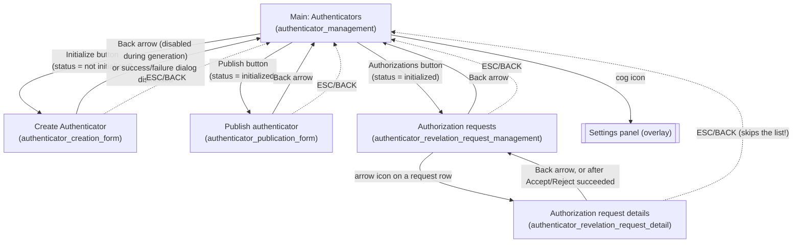

# 02 — UX and Screens

This file specifies everything the user sees and does in the **Witness Angel Authenticator** app (version 1.5): screens, labels, dialogs, validation rules, enabled/disabled states, background-thread behaviour and platform-specific UX. It is written so the app can be rebuilt from scratch in another framework. Kivy code is cited as evidence, but the behaviour is described as observable results.

Related specifications:
- [01](01-architecture-and-platform.md): storage roots and folder access, threading model, Back key, language detection, safe-area insets (owned there; this file only describes what the user sees).
- [03](03-business-logic.md): what the library functions named here do (keystore initialization, key generation, passphrase checks, trustee decryption).
- [04](04-data-and-protocols.md): the on-disk keystore format, ZIP archives, the config file, and the gateway JSON-RPC methods and payloads.
- [05](05-open-issues.md): bugs and their dispositions (`OI-nn`). A behaviour described here that 05 marks *fix* must not be copied.

Citation prefixes and source baseline: [README](README.md#source-baseline-and-citation-prefixes). Paths written `.py:NN` or `.kv:NN` refer to the source file named at the top of the section. Line numbers in `.kv` files are the file's own line numbers.

Translations: the source strings are English. The app *intends* to chain two French catalogs, the app's then the components' (`AUTH/waauthenticator/waauthenticator_gui.py:26`, `COMP/i18n.py:104-122`). **In 1.5 only the components catalog `COMP/locale/fr/LC_MESSAGES/witnessangel.po` is loaded**: the app catalog is registered at a path that does not exist ([01 §2.6](01-architecture-and-platform.md#26-internationalisation), [05 OI-50](05-open-issues.md#g-internationalisation)). Every UI string below is given as **EN / FR**, where FR is what French users see in 1.5. A string with no French translation in the loaded catalog is shown in English and is marked *(no FR)*. Strings that only the app catalog translates are marked *(app catalog, not loaded → EN)*, with the intended FR.

---

## 1. Global application shell

### 1.1 Window, theme, and general layout

| Aspect | Behaviour | Source |
|---|---|---|
| Window title (desktop) | `Witness Angel - Authenticator` (never translated) | `AUTH/waauthenticator/waauthenticator_gui.py:39`, `COMP/application/generic_gui.py:52` |
| App icon | `icons/witness_angel_logo_blue_64x64.png` | `AUTH/waauthenticator/waauthenticator_gui.py:46` |
| Theme | Material Design, light theme, primary palette **Blue**, hue **900** | `COMP/application/generic_gui.py:53-55` |
| Android orientation | Portrait only; not fullscreen (the status bar stays visible) | `AUTH/buildozer.spec:53,76` |
| Android permissions | Only `android.permission.INTERNET`. The authenticator never shows a runtime permission prompt. | `AUTH/buildozer.spec:97` |
| Root layout | A box padded by `application_margins` (the safe-area insets, [01 §5](01-architecture-and-platform.md#5-platform-specific-behaviour-requirements)). It holds the stack of 5 screens with a **global wait spinner** overlaid on top. | `AUTH/waauthenticator/waauthenticator_gui.kv:10-46` |
| Screen transitions | The toolkit's default slide transition (a swap transition is commented out). | `AUTH/waauthenticator/waauthenticator_gui.kv:7,19` |
| Mobile app pause | When the user switches apps, the app pauses and resumes without restarting or losing state. | `COMP/application/generic_gui.py:57-67` |

**Global wait spinner.** A 46×46 dp circular indeterminate spinner, centred on the window and hidden by default (`COMP/widgets/popups.py:132-136`). It is shown while background tasks run. It does **not** block input: buttons underneath stay clickable. (The toolkit spinner is not modal, and no code disables input; [05 OI-27](05-open-issues.md#d-publication).)

### 1.2 Screens

The app registers exactly 5 screens (`AUTH/waauthenticator/waauthenticator_gui.kv:21-43`, names from `COMP/screens/base.py:23-27`):

| Id | Title (EN / FR) | Purpose |
|---|---|---|
| `authenticator_management` (main/home) | Authenticators / Authentifieurs | Pick a storage location and see its state. Entry point for all operations. |
| `authenticator_creation_form` | Create Authenticator / Créer un Authentifieur | Create a new authenticator: owner, passphrase, hint, and 3 keypairs. |
| `authenticator_publication_form` | Publish authenticator / Publier l'authentifieur | Compare the local authenticator with the gateway and publish its public part. |
| `authenticator_revelation_request_management` | Authorization requests / Demandes d'autorisation | List the decryption ("revelation") requests from the gateway, in 3 tabs. |
| `authenticator_revelation_request_detail` | Authorization request details / Détails des demandes d'autorisation | Show one request and accept or reject it. |

**Shared state.** The four secondary screens all work on the **selected authenticator directory** (`selected_authenticator_dir`). It is owned by the main screen and mirrored into the others (`AUTH/waauthenticator/waauthenticator_gui.kv:28,33,38,43`). No other state is passed between screens, except that the list screen hands the chosen request object to the detail screen (§6.4).

### 1.3 Top bars

Every screen starts with a top app bar (elevation 8). It has a title, an optional left action (a Back arrow), and right-side icon actions. Each icon has a tooltip label (`COMP/widgets/layout_components.kv:26-29`). Tooltip labels:

| Icon | Tooltip EN / FR |
|---|---|
| `arrow-left` | Back / Retour |
| `refresh` | Refresh / Rafraîchir |
| `earth` | Language / Langue |
| `help-circle-outline` | Help / Aide |
| `cog` | Settings / Paramètres |

### 1.4 Feedback primitives (framework-neutral definitions)

| Primitive | Look and behaviour | Source |
|---|---|---|
| **Toast** | A small temporary message. 1.5 s on desktop; native "short" toast on Android (about 2 s). It cannot be dismissed. | `COMP/widgets/popups.py:26-33` |
| **Snackbar** | A full-width bar at the bottom of the screen, shown for 3.5 s. Used for errors. | `COMP/widgets/popups.py:36-44` |
| **Dialog** | A modal dialog with a title, a text or custom content, optional action buttons, and **always** a last "close" button (default label Close / Fermer; often overridden to Cancel / Annuler). Tapping outside does **not** close it (`auto_dismiss=False`). Only one dialog is "registered" as current at a time; that is the dialog that ESC/BACK closes. | `COMP/widgets/popups.py:61-87,95-126` |
| **Help popup** | A dialog that is 95% of the window width, with the body text at 13 sp, the given title, and a single Close / Fermer button. | `COMP/widgets/popups.py:90-92` |
| **Unexpected-error guard** | Most user-triggered handlers are wrapped in a guard. Any uncaught exception is logged with its traceback and shows a **snackbar**: `Abnormal error caught: <ExceptionClassName>` / `Erreur anormale détectée : <ExceptionClassName>`. The operation then stops silently; the screen is not reset. | `COMP/widgets/popups.py:46-58`, `COMP/logging/handlers.py:31-38` |

**Background task model.** Owned by [01 §2.3](01-architecture-and-platform.md#23-threading-model-requirement-no-blocking-of-the-ui-thread): one worker thread, spinner shown while a task runs, result callback on the UI thread, spinner always hidden. If a task raises, its result callback is not called and the unexpected-error snackbar is shown. Key generation also shows the spinner (through the older decorator `process_method_with_gui_spinner`, `COMP/widgets/popups.py:142-156`). Which operations use the worker in 1.5 is stated per screen below.

### 1.5 Back navigation (ESC on desktop, BACK on Android)

Rules owned by [01 §2.2](01-architecture-and-platform.md#22-back--escape-key-all-platforms): close the open dialog or file browser; else go **straight to the main screen**; else let the key through (Android closes or backgrounds the app, desktop ESC normally closes the window). Visible consequences: from the request-detail screen BACK skips the request list, unlike the on-screen Back arrow ([05 OI-43](05-open-issues.md#f-user-interface)); during key generation BACK leaves the form while generation goes on ([05 OI-12](05-open-issues.md#b-creation-check-passphrase)).

---

## 2. Navigation map



What runs each time a screen is entered (its "on enter" hook):

| Screen | On enter | Source |
|---|---|---|
| Main | Rebuild the location list and reselect the previously selected entry. Also runs once at startup. | `COMP/screens/authenticator_management.kv:32`, `COMP/screens/authenticator_management.py:97-99` |
| Create | Reset the form: fields empty and enabled, button enabled, status text empty, progress 0, top bar enabled | `COMP/screens/authenticator_creation_form.kv:6`, `.py:51-56` |
| Publish | Refresh the synchronization status (gateway query in the background) | `COMP/screens/authenticator_publication_form.kv:5` |
| Requests list | Switch to the first tab and fetch the requests (gateway query in the background) | `COMP/screens/authenticator_revelation_request_management.kv:6`, `.py:127-143` |
| Request detail | Nothing; its content is set up by the list screen before navigating | `COMP/screens/authenticator_revelation_request_detail.kv:9` |

---

## 3. Main screen — "Authenticators" (`authenticator_management`)

Sources: `COMP/screens/authenticator_management.py`, `COMP/screens/authenticator_management.kv`.

### 3.1 Layout (top to bottom, whole screen vertically scrollable)

1. **Top bar.** Title `Authenticators` / `Authentifieurs`. No left action. Right actions in this order: **Refresh**, **Language**, **Help**, **Settings** (`.kv:38-40`).
2. **Banner** (elevated strip, 40 dp): `Please select an authenticator location` / `Veuillez sélectionner un emplacement d'authentifieur` (`.kv:42-46`).
3. **Location list** (scrollable, takes a flexible share of the height) (`.kv:48-52`). See §3.2.
4. **Status strip** (elevated, 40 dp). A status icon (80 dp wide) followed by the status message (`.kv:54-65`). See §3.3.
5. **Information area.** Read-only, selectable and copyable multi-line text (scrollable, flexible height). Initial text: `No information available` / `Aucune information disponible` (`.kv:67-72`). See §3.4.
6. **Button group A** (2 columns), enabled **only when status = "not initialized"** (`.kv:74-87`):
   - **Initialize** (bold label; icon `account-key-outline`) / `Initialiser`
   - **Import** (icon `database-import-outline`) / `Importer`
7. **Button group B** (2 columns, 10 px padding), enabled **only when status = "initialized"** (`.kv:89-121`):
   - **Export** (`database-export-outline`) / `Exporter`
   - **Check** (`crosshairs-question`) / `Vérifier`
   - **Destroy** (`delete-alert-outline`) / `Détruire`
   - **Publish** (`share-all`) / `Publier`
   - **Authorizations** (`lock-open-outline`) / `Autorisations`

   (Rows: Export | Check, Destroy | Publish, Authorizations alone.)

### 3.2 Location list — entries and ordering

The list is rebuilt from scratch on every refresh (`.py:117-172`). Order is fixed:

| # | Entry | Primary text EN / FR | Secondary text EN / FR | Left icon | Right icon | Resolved authenticator directory |
|---|---|---|---|---|---|---|
| 1 | **User profile** (internal app storage) | User profile / Profil utilisateur | Stored inside system disk / Stocké dans le disque système | `account-box` | – | `INTERNAL_APP_ROOT/authenticator.keystore` (§7.1) |
| 2 | **Custom location** | Custom location / Emplacement personnalisé | The selected folder shown via the path shortener (§7.4), or `Please select a folder` / `Veuillez sélectionner un dossier` | `folder` | `file-find-outline`: opens the folder browser | `<selected folder>/authenticator.keystore`, or *empty* when no folder is selected |
| 3…n | **One entry per detected USB drive partition**, in detection order (desktop only) | `Drive {drive} ({label})` / `Disque {drive} ({label})`, where drive = mount point and label = partition label or `no name` / `sans nom` | `Size: {size}, Filesystem: {filesystem}` / `Taille : {size}, Format : {filesystem}`. Size uses 1024 steps without decimals (e.g. `14GB`); filesystem is upper-cased | `usb-flash-drive` | – | `<mountpoint>/.authenticator` if that folder exists, else `<mountpoint>/authenticator.keystore` (`witness-angel-cryptolib/src/wacryptolib/authdevice.py:13-17`) |

Details:
- USB detection calls `wacryptolib.authdevice.list_available_authdevices()`. On Android and iOS the result is always an empty list, so no Drive row appears; the reasons are in [01 §4](01-architecture-and-platform.md#4-storage-locations-exact-per-os) (Android: the macOS branch runs and finds no `system_profiler`; the screen's `except ModuleNotFoundError` at `.py:121-124` only mattered for Python ≤3.12 builds).
- Size formatting: `convert_bytes_to_human_representation` (`COMP/utilities/__init__.py:93-99`), with units `bytes, KB, MB, GB, TB`, integer part only, no space before the unit.
- **Selection.** Tapping a row selects it. Every row gets the light background and the selected row gets the darkest background (`.py:260-265`). Selecting a row immediately recomputes the status and information (§3.3, §3.4).
- **Default selection** after a refresh: the previously selected directory if it still matches a row; otherwise row 1, **User profile** (`.py:223-247`).
- After each refresh, on **desktop only**, a toast says `Refreshed authenticator locations` / `Emplacements d'authentifieurs rafraichis`. Mobile does not show it, because it would be intrusive (`.py:169-170`).
- When the language changes from this screen, the list is rebuilt so the drive labels are translated again (`.py:112-114`).

### 3.3 Status computation (ternary)

The status is computed by `display_authenticator_info()` (`.py:257-371`). It drives the status strip and the enabled state of the button groups:

| Condition (checked in order) | Status | Icon | Status message EN / FR | Information area text |
|---|---|---|---|---|
| Resolved dir is empty (Custom location with no folder chosen) | **None** (invalid) | `file-question-outline` | No valid location selected / Aucun emplacement valide sélectionné | `Please select an authenticator folder` / `Veuillez sélectionner un dossier d'authentifieur` |
| Not initialized (`wacryptolib.authenticator.is_authenticator_initialized(dir)` is false), and **parent folder does not exist** | None | same | same | `Path: <dir>` / `Chemin : <dir>` + blank line + `Selected folder is invalid!` / `Le dossier sélectionné est invalide !` |
| Not initialized, dir missing, and **parent not writable** | None | same | same | Path line + `Beware, parent folder is NOT writable!` / `Attention, le dossier parent n'est PAS accessible en écriture !` |
| Not initialized, dir exists but **is not a folder** | None | same | same | Path line + `Beware, this is not a folder!` / `Attention, ce n'est pas un dossier !` |
| Not initialized, dir is a folder but **not writable** | None | same | same | Path line + `Beware, this folder is NOT writable!` / `Attention, ce dossier n'est PAS accessible en écriture !` |
| Not initialized but creatable | **False** (not initialized) | `checkbox-blank-off-outline` | Authenticator not initialized / Authentifieur non initialisé | `Path: <dir>` only |
| Initialized but the metadata fails schema validation (`load_keystore_metadata` raises `SchemaValidationError`), including an unknown `keystore_format` or `keystore_type` value, an extra key, or a missing required key | None | `file-question-outline` | No valid location selected | `Invalid authenticator data in <dir>` / `Données d'authentifieur invalides dans <dir>`. This uses the **raw** path, not the shortened one. |
| Initialized, metadata is not valid JSON or has an unsupported `$binary` subtype (`JSONDecodeError` / `TypeError`) | *(unchanged: stale)* | *(stale)* | *(stale)* | *(stale)*, plus the snackbar `Abnormal error caught: JSONDecodeError`. Bug: [05 OI-18](05-open-issues.md#c-local-storage-import-export-destroy) (show "Invalid authenticator data" instead). |
| Initialized, valid, but **no `keystore_passphrase_hint`** (allowed by the schema, for example a foreign or keyfactory keystore) | *(unchanged: stale)* | *(stale)* | *(stale)* | *(stale)*, plus the snackbar `Abnormal error caught: KeyError` (`.py:335`). Bug: [05 OI-17](05-open-issues.md#c-local-storage-import-export-destroy) (show an empty hint instead). |
| Initialized and valid | **True** (initialized) | `check-circle-outline` | Authenticator initialized / Authentifieur initialisé | The information block below |

*Stale* means: the tapped row is highlighted, but the status, the information text and the selected directory all keep the previous row's values (they are assigned at the end of `display_authenticator_info`, `.py:366-372`, which the exception skips). The buttons therefore still act on the **previously** selected folder.

"Writable" is tested by actually creating and deleting a temporary sub-folder and file named `~test-folder-<random 0-100000>/~test-file.tmp` (`COMP/system_permissions.py:74-91`). "Readable" means the folder can be listed (`COMP/system_permissions.py:94-105`). The "parent exists" check only looks at the parent folder, because creation makes only one folder level.

**Information block for an initialized authenticator** (`.py:307-364`). The separator is `COLON()`: EN `": "`, FR `" : "`.

```
Path: <shortened path>

User: <keystore_owner>
Password hint: <keystore_passphrase_hint>
Creation date: <YYYY-MM-DD at HH:MM:SS UTC>   (or the hard-coded French "Inconnu" if the field is missing) ([05 OI-51](05-open-issues.md#g-internationalisation))
ID: <full keystore_uid>

Keypairs:
    RSA-OAEP …<last uid segment>                  (one line per keypair, indented 4 spaces)
    RSA-OAEP …<last uid segment> (missing private key)
```

Labels EN / FR: `Path`/`Chemin`, `User`/`Utilisateur`, `Password hint`/`Indice de phrase secrète`, `Creation date`/`Date de création`, `ID`/`ID`, `Keypairs`/`Paires de clés`. In the date, `at` / `à`. Keypairs appear in the order returned by `FilesystemKeystore.list_keypair_identifiers()` ([04 §2.1](04-data-and-protocols.md#21-folder-content)).

**Exact formatting functions** (`COMP/utilities/__init__.py`), used on every screen:

| Function | Output | Source |
|---|---|---|
| `COLON()` | EN `": "`, FR `" : "` (it is a translated msgid) | `:20` |
| `shorten_uid(uid)` | the single character `…` (U+2026 HORIZONTAL ELLIPSIS, not three dots) immediately followed by the last hyphen-separated group of `str(uid)`, e.g. `…3c46b519c841` | `:102-103` |
| `format_keypair_label(key_algo, keychain_uid, private_key_present)` | `key_algo` with `_` replaced by `-`, one space, `shorten_uid(keychain_uid)`, e.g. `RSA-OAEP …3c46b519c841`; when the private key is absent, one space and `(missing private key)` / `(clé privée manquante)` | `:128-151` |
| `format_authenticator_label(owner, keystore_uid)` | `<owner or "Unknown"/"Inconnu(e)"> (ID …<tail>)` | `:154-167` |
| `format_utc_datetime_label(dt, show_time)` | `YYYY-MM-DD`, plus with `show_time` one space, `at`/`à`, one space, `HH:MM:SS`, ` UTC` (seconds truncated, date taken in UTC) | `:193-206` |
| `format_revelation_request_label(created_at, description)` | `Request "<description truncated>" (<YYYY-MM-DD>)` / `Demande "<…>" (<date>)`; the description is cut to its first **40** code points followed by `…` (U+2026) when longer than 40, unchanged otherwise | `:170-190`, `truncate_chars` `:106-109` |
| `convert_bytes_to_human_representation(size)` | integer part and unit with no space, units `bytes`, `KB`, `MB`, `GB`, `TB` in steps of 1024, e.g. `14GB` | `:93-99` |
| `indent_text(text)` | each line prefixed with 4 spaces | `:123-125` |

### 3.4 Actions on the main screen

| Action | Precondition (UI) | Effect | Feedback |
|---|---|---|---|
| **Refresh** icon | always | Rebuild the list (§3.2) and keep the selection | desktop toast (§3.2) |
| **Language** icon | always | Opens a dropdown below the icon with `English` and `Français` (always shown in those native names) | see §8.2 |
| **Help** icon | always | Help popup titled `Authenticator management page` / `Page de gestion des authentifieurs` (texts in §3.5) | – |
| **Settings** icon | always | Opens the settings panel (§8.1) | – |
| Tap a row | always | Select it and update the status | – |
| Folder icon on "Custom location" | always | Folder browser (§7.2) | toast if storage is inaccessible |
| **Initialize** | status = False | Go to the Create screen | – |
| **Import** | status = False | ZIP file browser (§7.3) | dialogs (§3.6) |
| **Export** | status = True | Confirmation dialog, then export (§3.6) | dialogs |
| **Check** | status = True | Passphrase dialog, then the check (§3.7) | result dialog |
| **Destroy** | status = True | Confirmation dialog, then deletion (§3.8) | dialog |
| **Publish** | status = True | Go to the Publish screen | – |
| **Authorizations** | status = True | Go to the Requests list screen | – |

### 3.5 Main-screen help text

Shown as one popup, with paragraphs separated by single or double line breaks (`.py:570-594`):
1. `On this page, you can manage your authenticators, which are actually digital keychains identified by unique IDs.` / `Sur cette page, vous pouvez gérer vos authentifieurs, qui sont en fait des trousseaux de clés numériques identifiés par des ID uniques.`
2. `These keychains contain both public keys, which can be freely shared, and their corresponding private keys, protected by passphrases, which must be kept hidden.` / `Ces trousseaux contiennent à la fois des clés publiques, qui peuvent être partagées librement, et les clés privées correspondantes, protégées par des phrases secrètes, qui doivent rester cachées.`
3. *(blank line)* `Authenticators can be stored in your user profile or in a custom folder, especially at the root of removable devices.` / `Les authentifieurs peuvent être stockés dans votre profil utilisateur ou dans un dossier personnalisé, notamment à la racine des périphériques amovibles.`
4. `You can initialize new authenticators from scratch, import/export them from/to ZIP archives, or check their integrity by providing their passphrases.` / `Vous pouvez initialiser de nouveaux authentifieurs à partir de zéro, les importer/exporter depuis/vers des archives ZIP, ou vérifier leur intégrité en fournissant leurs phrases secrètes.`
5. *(blank line)* `Note that if you destroy an authenticator, or lose its passphrase, the WitnessAngel recordings which used it as a trusted third party might not be decryptable anymore.` / `Notez que si vous détruisez un authentifieur, ou perdez sa phrase secrète, les enregistrements WitnessAngel qui l'utilisaient en tant que tiers de confiance risquent de ne plus pouvoir être déchiffrés.` (`COMP/locale/fr/LC_MESSAGES/witnessangel.po:541-548`)

### 3.6 Import / Export

**Export** (`.py:400-437`):
1. A dialog titled `Export authenticator` / `Exporter l'authentifieur`, text `The exported archive should be kept in a secure place.` / `L'archive exportée doit être gardée en lieu sûr.`, buttons **Confirm** / `Confirmer` and **Cancel** / `Annuler`.
2. On Confirm, the dialog closes. The exports folder `EXTERNAL_EXPORTS_DIR` ([01 §4](01-architecture-and-platform.md#4-storage-locations-exact-per-os)) must be an existing, readable and **writable** folder. If not, the toast `External storage is not accessible` / `Stockage externe non accessible` appears and nothing else happens.
3. The app builds a ZIP of the whole authenticator folder. The name is `authenticator_id<last uid segment>_date<YYYYMMDDHHMMSS UTC>.zip` and it is written to the exports folder. This runs **synchronously on the UI thread**, with no spinner.
4. A dialog titled `Export successful` / `Exportation réussie`, text `Authenticator archive exported to <shortened path>` / `L'archive de l'authentifieur a été exportée vers <path>`, button Close.

**Import** (`.py:373-398`), available only when the selected location is *not initialized* but creatable:
1. If the exports folder is missing or unreadable: toast `External storage is not accessible`.
2. Otherwise a file browser opens on the exports folder, showing only `.zip` files (`.py:105-110`).
3. When a file is picked, the browser closes. The ZIP is extracted **into the selected authenticator directory**, creating it if needed. Existing files may be **overwritten**. Nothing is validated. This runs synchronously, with no spinner. ([05 OI-20](05-open-issues.md#c-local-storage-import-export-destroy))
4. A dialog titled `Import successful` / `Importation réussie`, text `Authenticator archive unpacked from <archive file name>, its integrity has not been checked though.` / `L'archive d'authentifieur a été décompressée depuis <nom>, son intégrité n'a cependant pas été vérifiée.`
5. The list refreshes, so the status usually becomes "initialized".

Errors (a corrupt ZIP, I/O errors) show the unexpected-error snackbar.

### 3.7 Check (passphrase / integrity test)

`.py:473-563`:
1. A dialog titled `Sanity check` / `Contrôle d'intégrité` with custom content:
   - a description line, `Test integrity and passphrase of authenticator` / `Tester l'intégrité et la phrase secrète de l'authentifieur`;
   - a single-line text field with hint `Passphrase` / `Phrase secrète`. It **gets the keyboard focus when the dialog opens**. The text is **not masked**.

   Buttons: **Check** / `Vérifier` and **Cancel** / `Annuler`.
2. On Check, the dialog closes and the test runs **synchronously on the UI thread** (no spinner; the UI freezes while keys are decrypted; [05 OI-42](05-open-issues.md#f-user-interface)). The screen passes the raw text of the field; the key layer normalises it (strip + NFKC, [04 §4.3](04-data-and-protocols.md#43-private-key-pem-passphrase-protected)), so leading or trailing spaces do not matter. For each keypair returned by `FilesystemKeystore.list_keypair_identifiers()`:
   - if the private key is absent, the keypair counts as "missing";
   - otherwise `wacryptolib.keygen.load_asymmetric_key_from_pem_bytestring(key_pem, key_algo, passphrase)` is tried, and a `KeyLoadingError` makes the keypair count as "wrong passphrase".
3. A result dialog with a Close button:
   - **Success**: there is at least 1 keypair, none missing, none undecodable. Title `Checkup result: Success` / `Résultat du contrôle : Succès`. Text `Keypairs successfully tested: <n>` / `Paires de clés testées avec succès : <n>`.
   - **Failure**: any other outcome, **including 0 keypairs**. Title `Checkup result: Failure` / `Résultat du contrôle : Échec`. Text over three lines:
     `Keypairs tested: <n>` / `Paires de clés testées : <n>`
     `Missing private keys: <comma-separated keypair labels or ->` / `Clés privées manquantes : …`
     `Wrong passphrase for keys:  <labels or ->` (two spaces after the colon) / `Mauvaise phrase secrète pour les clés :  …`

### 3.8 Destroy

`.py:439-471`:
1. A dialog titled `Destroy authenticator` / `Détruire l'authentifieur`, text `Beware, this might make encrypted data using these keys impossible to decrypt.` / `Attention, cela peut rendre impossible le déchiffrement des données chiffrées utilisant ces clés.`, buttons **Confirm** / `Confirmer` and **Cancel** / `Annuler`. The target directory is captured **when the dialog opens**.
2. On Confirm, the **whole authenticator folder is deleted recursively**. This runs synchronously, with no spinner and no second confirmation. ([05 OI-19](05-open-issues.md#c-local-storage-import-export-destroy))
3. A dialog titled `Deletion is over` / `Destruction terminée`, text `Folder <raw absolute path> has been properly removed.` / `Le dossier <path> a été correctement supprimé.`
4. The list refreshes, and the status becomes "not initialized".

If the folder is already gone, the internal `ValueError("Path … not found …")` shows as the snackbar `Abnormal error caught: ValueError`.

---

## 4. Create screen — "Create Authenticator" (`authenticator_creation_form`)

Sources: `COMP/screens/authenticator_creation_form.py`, `.kv`.

### 4.1 Layout

1. **Top bar.** Title `Create Authenticator` / `Créer un Authentifieur`. Left: **Back** (to main). Right: **Help** (`.kv:11-15`).
2. A label `Authenticator: <shortened target dir>` / `Authentifieur : <dir>` (`.kv:21-22`).
3. Three single-line text fields with floating hint labels (`.kv:24-42`). **None is masked; the passphrase is typed in clear text.**
   - `User name` / `Utilisateur`
   - `Passphrase` / `Phrase secrète`
   - `Passphrase hint` / `Indice de phrase secrète`
4. A 20 px spacer, then the **Initialize** / `Initialiser` button. It is outlined, takes half the width, is centred, and is 50 dp high (`.kv:46-58`).
5. A flexible empty space, then the operation status label (empty by default) (`.kv:62-68`).
6. A horizontal progress bar 10 dp high, value 0–100, starting at 0 (`.kv:70-75`).

On every entry the form is reset: fields emptied and enabled, button enabled, status text empty, progress 0, top bar enabled (`.py:51-56`).

### 4.2 Validation (on Initialize)

All three values are **trimmed** first (`.py:58-63`). The rules are checked in this order, and only the first failure is reported (`.py:65-84`):

| # | Rule | Error text EN / FR |
|---|---|---|
| 1 | All three fields non-empty | `Please enter a username, passphrase and passphrase hint.` / `Veuillez entrer un nom d'utilisateur, une phrase secrète et son indice.` |
| 2 | No field longer than **100** characters | `Username, passphrase and passphrase hint must not exceed 100 characters` / `Le nom d'utilisateur, la phrase secrète et son indice ne doivent pas dépasser 100 caractères.` |
| 3 | Passphrase at least **20** characters, **unless it starts with `¤`** (a test back door that allows short passphrases) ([05 OI-10](05-open-issues.md#b-creation-check-passphrase)) | `Passphrase must be at least 20 characters long.` / `La phrase secrète doit faire au moins 20 caractères de long.` |

The error appears in a dialog titled `Validation error` / `Erreur de validation` with a Close button. The form keeps its values.

There is no rule on character classes, no confirmation field, and no check that the hint differs from the passphrase.

### 4.3 Generation (after valid input)

`.py:157-192`:
1. On the UI thread:
   - If the target directory does not exist, it is created. Only one level is created; the parent must exist.
   - The Initialize button is **disabled**.
   - The passphrase field text is replaced by `***` for privacy. The real value has already been captured.
   - The status label shows `Please wait, generation of cryptographic keys might take a few minutes.` / `Veuillez attendre, la génération des clés cryptographiques peut prendre quelques minutes.`
   - All three fields are unfocused and **disabled**. They keep their current text, including `***`.
   - The whole **top bar is disabled**, so Back and Help are unusable.
2. On the background worker, with the spinner shown (`.py:100-136`):
   - Progress goes to **10%**.
   - The UI calls `wacryptolib.authenticator.initialize_authenticator(dir, keystore_owner, keystore_passphrase_hint)`, which writes the metadata.
   - **3 times** (`GENERATED_KEYS_COUNT`, `.py:34`), it calls `wacryptolib.keygen.generate_keypair(key_algo="RSA_OAEP", passphrase=…)` and then `FilesystemKeystore.set_keypair(keychain_uid=generate_uuid0(), key_algo="RSA_OAEP", public_key, private_key)`. After key *i*, progress = `10 + int(i*90/3)`, i.e. **40% → 70% → 100%**.
   - Any exception is caught and logged, and the run is marked a failure.
3. On the UI thread, the result dialog (Close button):
   - Success: title `Success` / `Succès`, text `Initialization successfully completed.` / `Initialisation complétée avec succès.`
   - Failure: title `Failure` / `Échec`, text `Operation failed, check logs.` / `Opération échouée, vérifiez les logs.`

   In **both cases**, closing the dialog (button or ESC/BACK) goes back to the **main screen**. The main screen then refreshes and shows the new status.

There is no cancel button during generation (but ESC/BACK leaves the screen, [05 OI-12](05-open-issues.md#b-creation-check-passphrase)).

### 4.4 Help text

Title `Authenticator creation page` / `Page de création d'authentifieur` (`.py:194-209`):
1. `On this page, you can initialize an authenticator inside an empty folder; this authenticator actually consists in metadata files as well as a set of asymmetric keypairs.` / `Sur cette page, vous pouvez initialiser un authentifieur dans un dossier vide ; cet authentifieur consiste en réalité en des fichiers de métadonnées, ainsi qu'en un ensemble de paires de clés asymétriques.`
2. `To proceed, you have to input your user name or pseudo, a long passphrase (e.g. consisting of 4 different words), and a public hint to help your remember your passphrase later.` / `Pour procéder, vous devez entrer votre nom d'utilisateur ou pseudo, une longue phrase secrète (par exemple, composée de 4 mots différents), et un indice public pour vous aider à vous souvenir de votre phrase secrète plus tard.`
3. `You should keep your passphrase somewhere safe (in a digital password manager, on a paper in a vault...), because if you forget any of its aspects (upper/lower case, accents, spaces...), there is no way to recover it.` / `Vous devez conserver votre phrase secrète en lieu sûr (dans un gestionnaire de mots de passe numérique, sur un papier dans un coffre-fort...), car si vous oubliez l'un de ses aspects (majuscules/minuscules, accents, espaces...), il n'y a aucun moyen de la récupérer.`

---

## 5. Publish screen — "Publish authenticator" (`authenticator_publication_form`)

Sources: `COMP/screens/authenticator_publication_form.py`, `.kv`. Reached only when the status is "initialized".

### 5.1 Layout

1. **Top bar.** Title `Publish authenticator` / `Publier l'authentifieur`. Left: **Back** (to main). Right: **Refresh**, **Help** (`.kv:10-14`).
2. A scrollable, read-only, selectable text area (about 8/10 of the height) holding the synchronization report. It is empty at first (`.kv:21-31`).
3. A 20 px spacer, then the **Publish** / `Publier` button. It is half width, centred, 50 dp high, and **disabled unless publishing is allowed** (default: disabled) (`.kv:35-47`).

### 5.2 Refresh synchronization status (on enter and on Refresh)

`.py:115-219`:
1. On the UI thread, the text area is cleared. The local metadata and public-key list are read **synchronously**, using `load_keystore_metadata` and `ReadonlyFilesystemKeystore.list_keypair_identifiers()`.
2. On the background worker (spinner shown), the UI calls `gateway_proxy.get_public_authenticator(keystore_uid=…)`. An `ExistenceError` means "not published". A `JSONRPCError` or `OSError` becomes the error message `Error querying gateway server, please check its url and you connectivity` *(sic, "you")* / `Erreur lors de l'appel au serveur gateway, veuillez vérifier son url et votre connectivité`.
3. On the UI thread, the Publish button is first disabled again, then:
   - **Gateway error.** The text area shows `No information available` / `Aucune information disponible` and a snackbar shows the error message. Stop.
   - **Not published.** Status `NOT PUBLISHED` / `NON PUBLIÉ`, message `The local authenticator does not exist in the remote repository.` / `L'authentifieur local n'existe pas dans le dépôt distant.` The **Publish button becomes enabled**.
   - **Published.** Status `PUBLISHED` / `PUBLIÉ`. The local and remote key sets are compared as `(keychain_uid, key_algo)` pairs (`.py:76-99`):
     - In sync: message `The remote authenticator is up to date.` / `L'authentifieur distant est à jour.`
     - Out of sync: message `An inconsistency has been detected between the local and remote authenticator.` / `Une incohérence a été détectée entre l'authentifieur local et distant`, plus an "Error details" block (below).
     - The Publish button stays disabled either way: a published authenticator cannot be modified.
4. The report text:

```
Authenticator path: <shortened path>
User: <keystore_owner>
ID: <full keystore_uid>

Gateway: <configured gateway URL>
Remote status: <NOT PUBLISHED | PUBLISHED>
Message: <message>
[if published:]

Provide the Authenticator ID to users wanting to rely on you as a Key Guardian
[if inconsistent:]

Error details:
    Exceeding key(s) in remote: <…>
    Missing key(s) in remote: <…>
```

   Labels EN / FR: `Authenticator path`/`Chemin d'authentifieur`, `User`/`Utilisateur`, `ID`, `Gateway`/`Passerelle`, `Remote status`/`Statut distant`, `Message`/`Message`, `Provide the Authenticator ID to users wanting to rely on you as a Key Guardian`/`Fournissez l'ID d'Authentifieur aux utilisateurs désirant vous ajouter comme Gardien de Clés`, `Error details`/`Détails d'erreurs`, `Exceeding key(s) in remote`/`Clés en excès côté distant`, `Missing key(s) in remote`/`Clés manquantes côté distant`. Key lists use shortened uids (`…<last segment>`), comma-separated, or `-` when empty. They currently render wrapped in a tuple representation ([05 OI-33](05-open-issues.md#d-publication)).

5. A toast: `Remote authenticator status has been updated` / `Le statut de l'authentifieur distant a été actualisé`.

### 5.3 Publish

`.py:221-252`. On **Publish**, the background worker (spinner shown) builds the payload: `keystore_owner`, `keystore_uid`, `keystore_secret`, optionally `keystore_creation_datetime`, and `public_keys` = a list of `{keychain_uid, key_algo, key_value}`, where key_value comes from `ReadonlyFilesystemKeystore.get_public_key`. It then calls `gateway_proxy.set_public_authenticator(**payload)`; see 04. On success, the synchronization status is refreshed (§5.2), so the screen typically shows PUBLISHED and the button becomes disabled. On failure, the unexpected-error snackbar appears and nothing is refreshed. **No confirmation dialog is shown before this irreversible action** ([05 OI-26](05-open-issues.md#d-publication)). All public keys are sent, even those whose private key is missing ([05 OI-28](05-open-issues.md#d-publication)).

### 5.4 Help text

Title `Authenticator publishing` / `Publication de l'authentifieur` (`.py:254-266`):
1. `This page allows to publish the PUBLIC part of an authenticator to a remote Witness Angel Gateway, so that other users may import it to secure their recordings.` / `Cette page permet de publier la partie PUBLIC d'un authentifiant sur une passerelle Witness Angel distante, afin que d'autres utilisateurs puissent l'importer pour sécuriser leurs enregistrements.`
2. `For now, a published authenticator can't be modified or deleted.` / `Pour l'instant, un authentifiant publié ne peut pas être modifié ou supprimé.`
3. `In case of incoherences between the keys locally and remotely stored, these errors are displayed here.` / `En cas d'incohérences entre les clés stockées localement et à distance, ces erreurs sont affichées ici.`

---

## 6. Authorization requests

### 6.1 List screen — "Authorization requests" (`authenticator_revelation_request_management`)

Sources: `COMP/screens/authenticator_revelation_request_management.py`, `.kv`. Reached only when the status is "initialized".

**Layout:**
1. **Top bar.** Title `Authorization requests` / `Demandes d'autorisation`. Left: **Back** (to main). Right: **Refresh**, **Help** (`.kv:11-15`).
2. **Tabs**, stretched across the full width, in this order (`.kv:17-58`):
   1. `Pending` / `En cours`, for status `PENDING`
   2. `Accepted` / `Accepté`, for status `ACCEPTED`
   3. `Rejected` / `Rejeté`, for status `REJECTED`
3. Each tab holds a scrollable list. When the list is empty, the tab shows a large centred placeholder (20 sp) `Empty` / `Vide`.

**List row** (`COMP/widgets/layout_components.kv:111-121`). Two lines:
- left icon `file-arrow-left-right`;
- primary text `Request "<description, truncated to 40 chars + …>" (<YYYY-MM-DD>)` / `Demande "<…>" (<date>)` (`COMP/utilities/__init__.py:170-190`) (see `format_revelation_request_label` in §3.3);
- secondary text `Symkey decryption requests: <n>` / `Requêtes de déchiffrement de symkey : <n>`;
- right icon `arrow-right-bold-hexagon-outline`. **Only tapping this icon** opens the detail screen. Tapping the row itself does nothing.

**Ordering:** within each tab, rows are sorted by `created_at`, **newest first** (`.py:64`).

**Fetch** (on enter and on Refresh) (`.py:99-143`):
1. Switch to the first tab (Pending).
2. On the background worker (spinner shown): read the local metadata, then call `gateway_proxy.list_authenticator_revelation_requests(authenticator_keystore_secret=…, authenticator_keystore_uid=…)`. Requests are grouped by `revelation_request_status` into the keys PENDING, ACCEPTED and REJECTED.
3. Outcome:

| Outcome | Feedback EN / FR | Lists |
|---|---|---|
| Success | toast `Authorization requests were updated` / `Requêtes d'autorisation mises à jour` | filled |
| `KeystoreDoesNotExist` (not published) | snackbar `Authenticator does not exist in remote registry` / `L'authentifieur n'existe pas dans le registre distant` | all cleared → "Empty" |
| `AuthenticationError` | snackbar `The keystore secret of authenticator is not valid` / `Le secret de keystpre de l'authentifieur n'est pas valide` *(FR typo "keystpre")* | cleared |
| `JSONRPCError` / `OSError` | snackbar `Error querying gateway server, please check its url and your connectivity` / `Erreur lors de l'appel au serveur gateway, veuillez vérifier son url et votre connectivité` | cleared |
| Any other exception (e.g. an unknown status value → `KeyError`) | snackbar `Abnormal error caught: <Class>` | **not cleared** (stale content stays; [05 OI-05](05-open-issues.md#a-revelation-requests-accept--reject)) |

**Help:** title `Authorization requests page` / `Page de demandes d'autorisation` (`.py:145-162`):
1. `This page summarizes the authorization requests that have been sent to the selected authenticator, by people wishing to decrypt some of their containers.` / `Cette page résume les demandes d'autorisation qui ont été envoyées à l'authentifieur sélectionné, par des personnes souhaitant déchiffrer certains de leurs conteneurs.`
2. `These requests can be freely rejected. Else, to accept them, you must input your passphrase, which will be used to load your private keys and generate authorization tokens for the requester.` / `Les demandes peuvent être librement rejetées. Sinon, pour les accepter, vous devez saisir votre phrase secrète, qui sera utilisée pour charger vos clés privées et générer des jetons d'autorisation pour le demandeur.`
3. `For now, it is not possible to change the status of a request which has been accepted or rejected.` / `Pour l'instant, il n'est pas possible de modifier le statut d'une demande qui a été acceptée ou rejetée.`

### 6.2 Detail screen — "Authorization request details" (`authenticator_revelation_request_detail`)

Sources: `COMP/screens/authenticator_revelation_request_detail.py`, `.kv`.

**Layout** (whole screen scrollable):
1. **Top bar.** Title `Authorization request details` / `Détails des demandes d'autorisation`. Left: **Back** (to the **list** screen). No right actions (`.kv:15-18`).
2. A banner (elevated, 40 dp) with the request label, in the same format as the list row's primary text (`.kv:20-23`).
3. A read-only multi-line summary box (`.kv:25-31`, built at `.py:71-88`):

```
Status: <raw status, e.g. PENDING>             (value not translated)
Authenticator: <owner> (ID …<uid tail>)       (owner "Unknown"/"Inconnu(e)" if empty)
Description: <full description>
Local key for response: <ALGO-NAME …<uid tail>>
```

   Labels: `Status`/`Statut`, `Authenticator`/`Authentifieur`, `Description`/`Description`, `Local key for response`/`Clé locale pour la réponse`.
4. A list of **symkey decryption requests**, in server order (`.py:90-108`). Each is a two-line row:
   - left icon `key`;
   - primary `Key of container …<cryptainer uid tail>` / `Clé du conteneur …`;
   - secondary = the cryptainer name;
   - right icon `information-outline`, which opens a dialog.

   The dialog is titled `Symkey decryption request` / `Requêtes de déchiffrement de la Symkey` with a **Close** / `Fermer` button and the text:
   ```
   Concerned authenticator key: <ALGO …uid tail>
   Cryptainer metadata: <raw dict representation>
   Decryption status: <raw status>
   ```
   Labels: `Concerned authenticator key`/`Clé d'authentifieur concernée`, `Cryptainer metadata`/`Metadata du cryptainer `, `Decryption status`/`Statut de déchiffrement`.
5. Two buttons, enabled **only when the request came from the PENDING tab** (`.py:53`, `.kv:37-52`):
   - **Accept** (icon `check`) / `Accepter`
   - **Reject** (icon `close`) / `Rejeter`

### 6.3 Accept flow

`.py:145-252`:
1. A dialog titled `Enter your authenticator passphrase` / `Entrez votre phrase secrète d'authentifieur`. Description `This will allow unmasking the requested Symkey parts` / `Cela permettra de révéler les morceaux de Symkey requis`. A passphrase field (`Passphrase` / `Phrase secrète`), **not masked, not auto-focused**. Buttons **Accept** / `Accepter` and **Cancel** / `Annuler`.
2. On Accept, the dialog closes and processing runs **synchronously on the UI thread**, with no spinner. RSA decryption of several keys may freeze the UI ([05 OI-42](05-open-issues.md#f-user-interface)). The screen passes the raw text of the field; the key layer normalises it (strip + NFKC, [04 §4.3](04-data-and-protocols.md#43-private-key-pem-passphrase-protected)). Steps (algorithm and required input checks: [03 §7.3](03-business-logic.md#73-accept-the-decryption-algorithm)):
   - Read the local metadata (for `keystore_secret`).
   - Build `TrusteeApi(FilesystemKeystore(dir))`.
   - For each symkey decryption request: `trustee_api.decrypt_with_private_key(keychain_uid, cipher_algo, cipherdict, passphrases=[passphrase])`.
     - `KeyDoesNotExist` → status `PRIVATE_KEY_MISSING`. **This path is buggy** ([05 OI-01](05-open-issues.md#a-revelation-requests-accept--reject)): the first such item crashes with `Abnormal error caught: UnboundLocalError`; a later one makes the gateway refuse the whole call (error snackbar). It is a functional blocker, not a leak: such a request can never be accepted from 1.5. Required behaviour: send that item as `PRIVATE_KEY_MISSING` with empty response data.
     - `KeyLoadingError` → snackbar `Loading of authenticator private key failed (wrong passphrase?)` / `Le chargement de la clé privée d'authentifieur a échoué (mauvaise phrase secrète ?)`. **The whole operation is aborted** and nothing is sent; the user stays on the detail screen.
     - Otherwise, the decrypted bytes are re-encrypted with the request's response public key (`encrypt_bytestring`) and the item gets status `DECRYPTED`.
   - Call `gateway_proxy.accept_revelation_request(authenticator_keystore_secret, revelation_request_uid, symkey_decryption_results)`.
3. On success: a toast `The decryption request was accepted` / `La demande de déchiffrement a été acceptée`, then go to the **list screen**. Entering the list triggers a refetch, whose own toast `Authorization requests were updated` replaces the first one (a known FIXME, `COMP/screens/authenticator_revelation_request_management.py:113`). The accepted request then appears in the Accepted tab.
4. Gateway or other errors show the unexpected-error snackbar, and the user stays on the detail screen.

### 6.4 Reject flow

`.py:171-189, 254-271`:
1. A simple dialog titled `Do you want to reject this request?` / `Voulez-vous rejeter cette requête ?`, with no body and buttons **Reject** / `Rejeter` and **Cancel** / `Annuler`.
2. On Reject: synchronously (no spinner), the UI calls `gateway_proxy.reject_revelation_request(authenticator_keystore_secret, revelation_request_uid)`. No passphrase is needed.
3. On success: a toast `The authorization request was rejected` / `La demande d'autorisation a été rejetée`, then go back to the list (it refetches). Errors show the snackbar.

---

## 7. Authenticator location selection UX

### 7.1 Storage roots per platform

Owned by [01 §4](01-architecture-and-platform.md#4-storage-locations-exact-per-os) (paths per OS, legacy folder rename, best-effort creation) and [01 §4.4](01-architecture-and-platform.md#44-folder-access-requirement-level) (what folder access a reimplementation must provide). User-visible consequences:

- "User profile" is `INTERNAL_APP_ROOT/authenticator.keystore`, never visible to the user on mobile.
- The folder browser starts in `EXTERNAL_APP_ROOT` (Android `Android/data/org.witnessangel.authenticator/files`, iOS `Documents`, desktop `~/.witnessangel/external`), and Export/Import use its `exports/` sub-folder.
- On Android `EXTERNAL_APP_ROOT` may be absent (for example an ejected SD card); then the browser, Export and Import show the toast `External storage is not accessible` / `Stockage externe non accessible`.

### 7.2 Custom folder browser

`COMP/screens/authenticator_management.py:100-104, 193-221`:
- Opened by the `file-find-outline` icon on the Custom location row.
- If `EXTERNAL_APP_ROOT` is missing or unreadable, the toast `External storage is not accessible` appears and the browser does not open.
- **Start folder:** the previously chosen custom folder, if it still exists and is readable; otherwise `EXTERNAL_APP_ROOT`. The user can navigate anywhere the OS allows.
- The browser selects **folders**. Choosing one closes the browser and sets the custom folder. It then **automatically selects the Custom location row**, which recomputes the status. The authenticator itself goes in the sub-folder `authenticator.keystore` of the chosen folder.
- Closing the browser (its close control, or ESC/BACK) changes nothing.

### 7.3 ZIP file browser (Import)

The same browser component, in file mode, filtered to `.zip`, starting at `EXTERNAL_EXPORTS_DIR` (`.py:105-110, 373-379`).

### 7.4 Path display shortening

`format_path_for_display` (`COMP/application/_common_runtime_support.py:68-82`):
- An empty path displays as an empty string.
- On Android, a path under the external-storage root is shown as `<sdcard>/…`.
- A path under the user home is shown as `~/…`.

### 7.5 Persistence of the custom folder

- The config key `[authenticator] custom_authenticator_dir` defaults to empty (`AUTH/waauthenticator/config_defaults.ini:1-3`).
- **At startup**, a non-empty value is turned into an absolute path and becomes the custom folder. An empty value means "none"; it must not be read as the current directory (`AUTH/waauthenticator/waauthenticator_gui.py:57-63, 110-112`).
- **Every time the custom folder changes**, the new value is written immediately to the config file `INTERNAL_APP_ROOT/wakeygen_config.ini` (`AUTH/waauthenticator/waauthenticator_gui.py:48, 87-90`, `COMP/application/generic_gui.py:97-106`).
- The **selected row is not persisted**. Every launch starts with "User profile" selected ([05 OI-25](05-open-issues.md#c-local-storage-import-export-destroy)).
- On iOS the stored absolute path goes stale when the app container moves, so the custom location is "not remembered" ([05 OI-16](05-open-issues.md#c-local-storage-import-export-destroy); required behaviour in [01 §4.4](01-architecture-and-platform.md#44-folder-access-requirement-level)).

---

## 8. Settings, i18n, platform specifics

### 8.1 Settings panel

Opened from the cog icon on the main screen. On desktop, F1 opens it too (Kivy `App` default, INFO). The panel replaces the screen; its built-in Close button returns to the main screen (`COMP/application/generic_gui.py:28-31, 43-45, 88-95`). The toolkit's own technical settings are hidden.
- Panel title: `Authenticator settings` / `Authenticator settings` *(app catalog, not loaded → EN; intended FR `Paramètres de l'Authentifieur`, the catalog's `Paramètres Authentificator` has a typo)* (`AUTH/waauthenticator/waauthenticator_gui.py:41-43`).
- Items (`AUTH/waauthenticator/waauthenticator_gui.py:114-124`):
  1. **Witness Angel Gateway URL** / `Witness Angel Gateway URL` *(app catalog, not loaded → EN; intended FR `URL de la Passerelle Witness Angel`)*, with description `Registry where authenticators can be published` / `Registry where authenticators can be published` *(app catalog, not loaded → EN; intended FR `Registre où les authentifieurs peuvent être publiés`)*. A reimplementation SHOULD show the intended FR ([05 OI-50](05-open-issues.md#g-internationalisation)). A free-text string, shown truncated on one line (15 sp). Tapping it opens the toolkit's standard text-edit popup with OK/Cancel (toolkit-provided labels, not from the app catalogs). Section `[network] wagateway_url`. Default `https://api.witnessangel.com/gateway/jsonrpc/` (`AUTH/waauthenticator/config_defaults.ini:5-7`). It is **not validated** ([05 OI-47](05-open-issues.md#f-user-interface)). It is saved to the config file and read again on every gateway call (`AUTH/waauthenticator/waauthenticator_gui.py:107-108`, `COMP/application/_common_runtime_support.py:192-195`), so a change applies immediately with no restart.
  2. A title row `Authenticator v1.5 by Witness Angel` (never translated).

### 8.2 Languages

- Two languages: English (`en`) and French (`fr`). The **default** is detected at startup, as specified in [01 §2.6](01-architecture-and-platform.md#26-internationalisation) (`LANG` exactly `en`/`fr`, else the OS language; anything starting with `fr` gives French).
- The **switcher** is the `earth` icon on the main screen. It opens a dropdown of `English` and `Français`, 110 dp max height, opening downward (`COMP/widgets/layout_components.py:71-97`). Choosing one:
  - switches the catalog immediately;
  - updates every declaratively bound label on all screens;
  - rebuilds the main-screen location list;
  - destroys the settings panel so it is rebuilt in the new language next time (`COMP/application/generic_gui.py:108-110`).
- Text built in code on *other* screens (publish report, detail summary) keeps the old language until that screen is refreshed or rebuilt.
- The choice is **not persisted**; the next launch uses the detected default again ([05 OI-25](05-open-issues.md#c-local-storage-import-export-destroy)).

### 8.3 Safe-area insets

Owned by [01 §5](01-architecture-and-platform.md#5-platform-specific-behaviour-requirements). What the user sees: the whole app (top bars included) is inset so that nothing sits under the status bar, the navigation bar, the notch or the home indicator, in portrait; the area outside uses the window background.

### 8.4 Other platform notes

- On mobile, read-only text areas do not pop up the virtual keyboard when touched, but text can still be selected (`COMP/widgets/layout_components.py:100-126`).
- On desktop, multitouch emulation (red dots on right/middle click) is disabled. The window raises itself when the mouse enters it, so the first click registers (`COMP/application/_app_presetup.py:118-130`).
- USB drive detection exists only on desktop (Windows, Linux, macOS); see [01 §4](01-architecture-and-platform.md#4-storage-locations-exact-per-os).
- On an unhandled crash at Android startup, a crash report is sent to `https://api.witnessangel.com/support/crashdumps/` and the app exits. This is not done on iOS or desktop (`COMP/launcher.py:61-76`; consent: [05 OI-56](05-open-issues.md#h-platform-build-release)).

---

## 9. End-to-end user journeys (summary)

1. **Create (first launch).** The app opens with "User profile" selected and the status "Authenticator not initialized". The user taps **Initialize**, fills in the name, a passphrase of at least 20 characters and the hint, then taps **Initialize**. Progress goes 10 → 40 → 70 → 100% (possibly minutes on mobile). The **Success** dialog appears; closing it returns to the main screen, which now shows "Authenticator initialized" and the information block with 3 RSA-OAEP keypairs.
2. **Create on a USB key or custom folder.** Select the Drive row (desktop), or tap the Custom location folder icon and pick a folder. Then continue as in journey 1.
3. **Check the passphrase.** **Check** → type the passphrase → **Check** → result dialog: Success with the keypair count, or Failure with the missing or undecodable keys.
4. **Publish.** **Publish** → the screen queries the gateway and shows NOT PUBLISHED → tap **Publish** → the spinner shows → the report refreshes to PUBLISHED / "up to date". Give the displayed **ID** to people who want you as their Key Guardian.
5. **Handle a request.** **Authorizations** → Pending tab → tap the arrow icon on a request → review the summary and container keys (ⓘ for details) → **Accept** → type the passphrase → **Accept** → toast → back on the list, where the request is now under Accepted. Or: **Reject** → confirm → toast → it moves to Rejected. Accepted or rejected requests are read-only, with their buttons disabled.
6. **Back up / restore.** **Export** → Confirm → ZIP in the exports folder. To restore, select a location that is not initialized (for example after Destroy) → **Import** → choose the ZIP.
7. **Destroy.** **Destroy** → Confirm → the folder is deleted → the status returns to "not initialized". The gateway copy, if published, is untouched and cannot be deleted from the app.

---

## 10. Open issues

The UX issues formerly numbered 1-26 here are now in [05-open-issues.md](05-open-issues.md), with dispositions. Mapping: #1 → OI-01, #2 → OI-02, #3 withdrawn (the key layer normalises the passphrase), #4 → OI-13, #5 → OI-12, #6 → OI-11, #7 → OI-42, #8 → OI-27, #9 → OI-26, #10 → OI-33, #11 → OI-51 (the destroy-paragraph part withdrawn: it is translated), #12 → OI-52, #13 → OI-20, #14 → OI-19, #15 → OI-46, #16 → OI-16, #17 → OI-25, #18 → OI-43, #19 → OI-44, #20 → OI-05, #21 → OI-54, #22 → OI-55, #23 → OI-47, #24 → OI-10, #25 → OI-45, #26 → OI-53.
