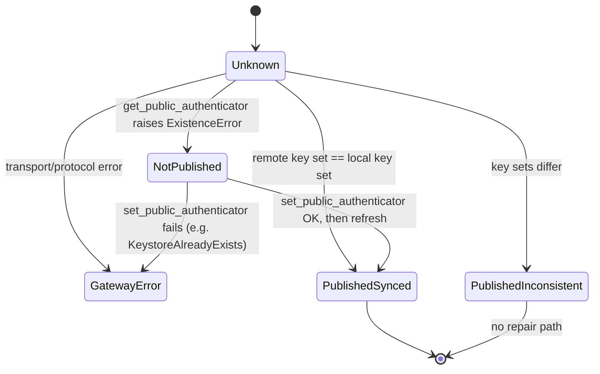
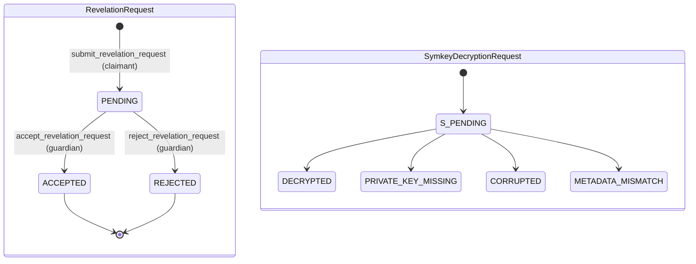
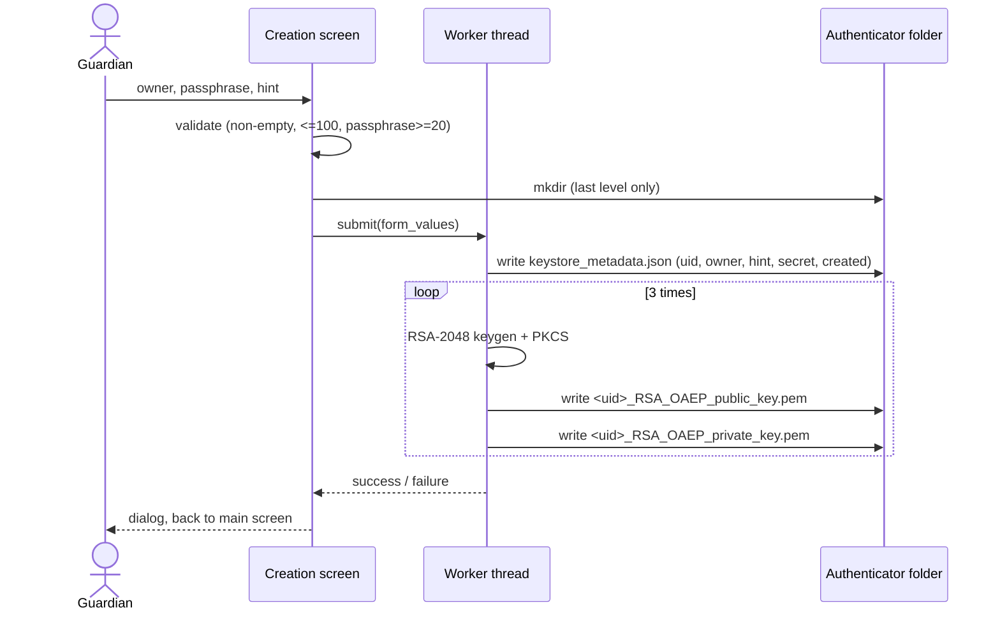
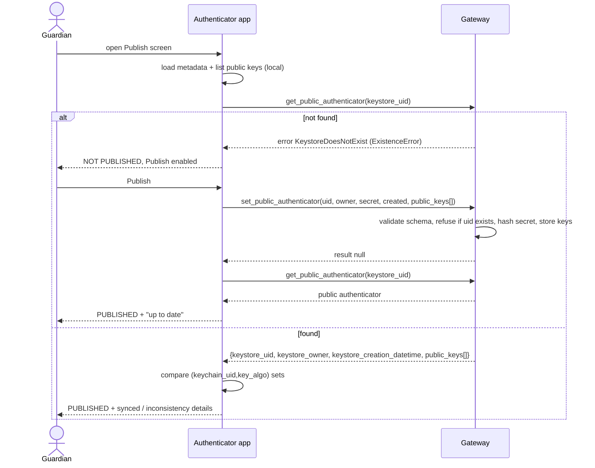

# 03 - Business logic specification

Witness Angel Authenticator, version 1.5. This file covers the domain: what an authenticator is, the states it goes through, and the exact rules for each operation (creation, passphrase check, publication, revelation requests, import/export, deletion). It also covers error handling and security properties. It is written so the logic can be rebuilt in another language and still work with existing authenticator folders, the existing Witness Angel gateway and the existing cryptolib clients.

Sibling files:

- [01](01-architecture-and-platform.md): app shell, threading, storage roots per OS, build.
- [02](02-ux-and-screens.md): screens, labels, dialogs, enabled/disabled states. UI details are not repeated here.
- [04](04-data-and-protocols.md): byte-level formats (folder layout, JSON schema, PEM/PKCS#8, RSA-OAEP layout, Extended JSON, JSON-RPC payloads). This file links to it with "see 04 §x". Its §0 is the normative interop checklist.
- [05](05-open-issues.md): bugs and their dispositions (`OI-nn`). Where 1.5 behaviour described here is a bug, the OI item says what to do instead.

Citation prefixes and source baseline: [README](README.md#source-baseline-and-citation-prefixes). Normative tags (MUST / SHOULD / INFO): [README](README.md#normative-language). Statements marked "debug builds only" rely on Python `assert`s, which release builds strip ([05 OI-40](05-open-issues.md#e-data-formats-and-crypto)).

The code is authoritative. Where the cryptolib docs (`witness-angel-cryptolib/docs/`) disagree with it, the difference is noted.

---

## 1. Domain concepts

| Concept | Definition | Evidence |
|---|---|---|
| **Keystore** | A storage of asymmetric keypairs indexed by `(keychain_uid, key_algo)`. On disk, it is a folder of PEM files plus an optional JSON metadata file. | `CRYPTO/keystore.py:126-327`, `:399-477` |
| **Authenticator** | A keystore with `keystore_type = "authenticator"`. It holds a fixed set of keypairs, all protected by the same passphrase, plus metadata (owner, passphrase hint, secret, creation date). It is the digital identity of a trusted person. | `CRYPTO/authenticator.py:57-65`, `witness-angel-cryptolib/docs/cryptolib_concepts.rst:46` |
| **Key guardian** (trustee of type `authenticator`) | The person who holds the authenticator and its passphrase. Recorders encrypt symmetric keys of their recordings with the guardian's public keys. | `witness-angel-cryptolib/docs/cryptoconf_examples.rst:122` |
| **Authdevice** | A removable drive that holds an authenticator folder at its root. | `CRYPTO/authdevice.py:13-17` |
| **Cryptainer** | An encrypted recording container. Its payload is encrypted with random symmetric keys ("symkeys"). Those keys are wrapped by one or more key cipher layers, which can end with an RSA-OAEP encryption under an authenticator public key. | `CRYPTO/cryptainer/_analysis.py:138-236` |
| **Web gateway** | An online JSON-RPC registry. It stores the *public* part of authenticators and relays revelation requests between claimants and guardians. Default URL: `https://api.witnessangel.com/gateway/jsonrpc/`. | `AUTH/waauthenticator/config_defaults.ini:7`, `SERVER/apps/wagateway/core.py` |
| **Public authenticator** | The gateway's copy of an authenticator: uid, owner, creation date, public keys. It has no private keys and no passphrase hint. The gateway stores only a *hash* of the keystore secret. | `SERVER/apps/wagateway/core.py:81-111`, `SERVER/apps/wagateway/models.py:48-56` |
| **Keystore secret** | A random token created with the authenticator. It is stored in clear in the local metadata and sent once at publication. Afterwards it is the bearer credential that authenticates the guardian to the gateway (listing, accepting and rejecting requests). | `CRYPTO/authenticator.py:63`, `SERVER/apps/wagateway/core.py:35-38` |
| **Claimant / requestor** | A device (for example a Witness Angel revelation station) that owns cryptainers and wants them decrypted. It is identified by `revelation_requestor_uid`. | `COMP/screens/claimant_revelation_request_creation_form.py:112-153` |
| **Revelation request** | A claimant's request to one authenticator. It carries a description, a one-time *response public key*, and a list of *symkey decryption requests*. | `SERVER/apps/wagateway/core.py:114-178` |
| **Symkey decryption request** | One ciphertext (a symkey or a Shamir shard, encrypted with RSA-OAEP under one authenticator public key) plus cryptainer info (uid, name, metadata). | `CRYPTO/cryptainer/_analysis.py:157-164` |
| **Symkey decryption result** | The guardian's answer for one symkey decryption request: the original request data, a status, and the decrypted plaintext re-encrypted with the response public key. | `COMP/screens/authenticator_revelation_request_detail.py:234-238` |

---

## 2. Authenticator locations

An authenticator is always a single folder. The three location types (`USER_PROFILE` → `<INTERNAL_APP_ROOT>/authenticator.keystore`, `CUSTOM_FOLDER` → `<chosen folder>/authenticator.keystore`, `USB_DEVICE` → `<mountpoint>/authenticator.keystore` or legacy `<mountpoint>/.authenticator`) are specified in [01 §4](01-architecture-and-platform.md#4-storage-locations-exact-per-os), the folder access a reimplementation needs in [01 §4.4](01-architecture-and-platform.md#44-folder-access-requirement-level), and the UI in [02 §3.2](02-ux-and-screens.md#32-location-list--entries-and-ordering).

A reimplementation MUST use the same folder names, including the legacy ones, so that existing authenticators are found.

---

## 3. State machines

### 3.1 Local authenticator state

The app computes a ternary status for the selected location (`True` / `False` / `None`) in `display_authenticator_info()` (`COMP/screens/authenticator_management.py:258-372`). Logically, it is this state machine:

```mermaid
stateDiagram-v2
    [*] --> NoLocation: no custom folder chosen
    [*] --> Probe: location selected
    Probe --> InvalidLocation: parent missing / not writable / path is a file / folder not writable
    Probe --> Uninitialized: no metadata file, location creatable
    Probe --> Corrupted: metadata file present but schema invalid
    Probe --> Initialized: metadata file valid
    Uninitialized --> Initializing: Create (form valid)
    Initializing --> Initialized: metadata + 3 keypairs written
    Initializing --> PartiallyInitialized: failure after metadata was written
    Uninitialized --> Initialized: Import ZIP (unchecked)
    Initialized --> Uninitialized: Destroy (rmtree)
    PartiallyInitialized --> Uninitialized: Destroy
    Corrupted --> Uninitialized: Destroy
    Initialized --> Initialized: Check passphrase / Export / Publish / handle requests
    NoLocation --> Probe: folder chosen
```



| Logical state | Detection rule (in this order) | UI status | Evidence |
|---|---|---|---|
| NoLocation | `authenticator_dir` is empty (custom folder not chosen yet) | `None` | `authenticator_management.py:272-274` |
| InvalidLocation | Not initialized, and: parent folder missing; or folder missing and parent not writable; or path exists but is not a folder; or folder not writable | `None` | `:276-290` |
| Uninitialized | No `keystore_metadata.json` and no legacy `.keystore.json` file, and the location can be created | `False` | `:291-292`, `CRYPTO/authenticator.py:71-88` |
| Corrupted | A metadata file exists but `load_keystore_metadata()` raises `SchemaValidationError` | `None` | `authenticator_management.py:297-302` |
| Initialized | A metadata file exists and passes schema validation | `True` | `:303-364` |
| PartiallyInitialized | Not detected separately. It looks like `Initialized`, with fewer keypairs than expected or with missing private keys (shown in the keypair list and in the Check result). | `True` | see §4.5, §5 |

Rules:

- "Initialized" is decided **only by the presence of a metadata file**. Neither the file content nor the keypairs are checked (`CRYPTO/authenticator.py:75-77`).
- An authenticator with zero keypairs but valid metadata is "Initialized".
- Corrupted metadata (invalid JSON) is a special case. `load_from_json_file()` raises `JSONDecodeError`, not `SchemaValidationError`. That error is not caught by the screen and ends in the generic error snackbar ([05 OI-18](05-open-issues.md#c-local-storage-import-export-destroy)).

### 3.2 Remote (publication) state

The remote state is computed on the Publish screen by `refresh_synchronization_status()` (`COMP/screens/authenticator_publication_form.py:116-219`):



- The two key sets are compared on `(keychain_uid, key_algo)` only. Key bytes are not compared (`authenticator_publication_form.py:77-99`).
- Publish is allowed only in `NotPublished` (`enable_publish_button = True` only in that branch, `:135-139`).
- A published authenticator cannot be changed or removed from the app or through the gateway API. The help text says so: "For now, a published authenticator can't be modified or deleted." (`:260`). The gateway refuses a second `set_public_authenticator` (`SERVER/apps/wagateway/core.py:97-99`).

### 3.3 Revelation request and symkey decryption states (gateway-owned)



| Item | Values | Evidence |
|---|---|---|
| Revelation request status | `PENDING` (initial), `ACCEPTED`, `REJECTED`. `ACCEPTED` and `REJECTED` are terminal: the gateway refuses accept/reject when the status is not `PENDING`. | `SERVER/apps/wagateway/models.py:77-80`, `core.py:232-235`, `:278-281`; client copy `COMP/screens/authenticator_revelation_request_management.py:92` |
| Symkey decryption status | `PENDING` (initial), `DECRYPTED`, `PRIVATE_KEY_MISSING`, `CORRUPTED`, `METADATA_MISMATCH`. The guardian may send any status except `PENDING`. | `SERVER/apps/wagateway/models.py:104-109`, `core.py:262-264`; client copy `COMP/screens/authenticator_revelation_request_detail.py:36-41` |

The app only ever sends `DECRYPTED` or (through a buggy path, see §7.4) `PRIVATE_KEY_MISSING`. `CORRUPTED` and `METADATA_MISMATCH` are never produced (`authenticator_revelation_request_detail.py:222` "FIXME handle cases of corruption or metadata mismatch???").

---

## 4. Creation (initialization)

### 4.1 Inputs and validation (GUI)

From `COMP/screens/authenticator_creation_form.py:58-84`:

| Field | Metadata key | Rule |
|---|---|---|
| Owner name | `keystore_owner` | Leading/trailing whitespace stripped. Must not be empty. At most 100 characters (`MAX_WA_CHARFIELD_LENGTH`, `:36`). |
| Passphrase | (never stored) | Stripped. Must not be empty. At most 100 characters. At least 20 characters (`PASSPHRASE_MIN_LENGTH`, `:35`), **unless it starts with `¤`** (test backdoor, `:76-81`; [05 OI-10](05-open-issues.md#b-creation-check-passphrase): remove it). |
| Passphrase hint | `keystore_passphrase_hint` | Stripped. Must not be empty. At most 100 characters. Stored **in clear** in the metadata. |

The checks run in this order: any field empty, then any field longer than 100, then passphrase too short. The first failing check gives the error message (texts in [02 §4.2](02-ux-and-screens.md#42-validation-on-initialize)).

Length is counted in Unicode code points (Python `len(str)`). The 100-character limit matches the gateway column `keystore_owner max_length=100` (`SERVER/apps/wagateway/models.py:29`).

### 4.2 Algorithm (GUI path)

`_launch_authenticator_initialization()` + `_offloaded_initialize_authenticator()` (`authenticator_creation_form.py:102-178`):

1. If the target folder does not exist, create it. Only the last path component may be created (`mkdir(parents=False)`, `:165-166`).
2. Blank the passphrase field in the UI (`"***"`, `:170`). The real value is kept in `form_values`.
3. On a worker thread ([01 §2.3](01-architecture-and-platform.md#23-threading-model-requirement-no-blocking-of-the-ui-thread)):
   1. Call `initialize_authenticator(dir, keystore_owner, keystore_passphrase_hint)` (`CRYPTO/authenticator.py:24-68`):
      - Raise `KeystoreAlreadyExists` if the folder already looks initialized (`:40-41`).
      - Assert that neither `.keystore.json` nor `keystore_metadata.json` exists (`:53-55`; debug builds only, the check above already covers it).
      - Build the metadata (all fields in [04 §2.2](04-data-and-protocols.md#22-keystore_metadatajson-schema)):
        - `keystore_type = "authenticator"`
        - `keystore_format = "keystore_1.0"`
        - `keystore_uid = uuid0()`
        - `keystore_owner`
        - `keystore_passphrase_hint`
        - `keystore_secret = token_urlsafe(64)`
        - `keystore_creation_datetime = now(UTC)`
      - Validate the metadata against `KEYSTORE_METADATA_SCHEMA`, then write `keystore_metadata.json` (`:66-67`).
   2. Three times (`GENERATED_KEYS_COUNT = 3`, `authenticator_creation_form.py:34`), do:
      - `generate_keypair(key_algo="RSA_OAEP", passphrase=<passphrase>)`, which gives RSA-2048 with the private key PEM-encrypted under the passphrase (`CRYPTO/keygen.py:56-101`, see [04 §4](04-data-and-protocols.md#4-asymmetric-keys)).
      - `FilesystemKeystore.set_keypair(keychain_uid=uuid0(), key_algo="RSA_OAEP", ...)`, which writes the public PEM file first, then the private PEM file (`CRYPTO/keystore.py:216-233`, `:536-542`).
   3. The progress bar goes to 10% after the metadata, then +30% per keypair (`:110`, `:130`).
4. On success: "Initialization successfully completed."; on any exception: "Operation failed, check logs." (`:180-192`). In both cases the app returns to the main screen.



### 4.3 Generated data summary

| Item | Value |
|---|---|
| Number of keypairs | 3 (GUI). The CLI `flightbox authenticator create` takes `--keypair-count`, which must be at least 1 (`CRYPTO/operations.py:33-43`). |
| Key type | `RSA_OAEP` only, used for encryption (`authenticator_creation_form.py:122-125`; the CLI says "No choice for now", `CRYPTO/operations.py:68`) |
| Key size | 2048 bits (default `key_length_bits=2048`, `CRYPTO/keygen.py:57`). The minimum enforced anywhere is 2048 (`CRYPTO/keygen.py:192-195`). |
| `keychain_uid` | A new uuid0 per keypair, independent of `keystore_uid` |
| Private key protection | PKCS#8 encryption with the passphrase (PBES2 / PBKDF2-HMAC-SHA1 / AES-256-CBC). Parameters in [04 §4.3](04-data-and-protocols.md#43-private-key-pem-passphrase-protected). |
| Passphrase normalization | Before use as key material, the passphrase is `strip()`-ed, NFKC-normalized and UTF-8 encoded (`CRYPTO/keygen.py:16-18`). |
| Secret | `secrets.token_urlsafe(64)`: 64 random bytes in base64url without padding, so 86 ASCII characters from `[A-Za-z0-9_-]` (`CRYPTO/authenticator.py:63`) |

### 4.4 Atomicity and failure behaviour

- The **GUI path has no rollback**. If keypair generation fails after the metadata was written (for example because the app is killed or storage runs out), the folder stays "Initialized" with 0-2 keypairs. A retry is refused with `KeystoreAlreadyExists`. The user must Destroy it first.
- The **CLI path** (`CRYPTO/operations.py:45-89`) is different. It requires that the target folder does not exist, and on exception it deletes the folder (`delete_authenticator`). A reimplementation SHOULD follow the CLI behaviour ([05 OI-11](05-open-issues.md#b-creation-check-passphrase)).
- Files are written with plain `write_bytes`. There is no temp file and no fsync (`CRYPTO/keystore.py:532-534`). `FilesystemKeystore` notes that it is "not safe to use in multiprocessing environment, or in a process which can be brutally shutdown" (`:520-523`).

### 4.5 Invariants of a well-formed authenticator

1. `keystore_metadata.json` exists and validates against the schema ([04 §2.2](04-data-and-protocols.md#22-keystore_metadatajson-schema)). `keystore_type == "authenticator"`. `keystore_passphrase_hint` and `keystore_secret` are present (the schema marks them optional, but the screens, publication and revelation flows require them, [05 OI-17](05-open-issues.md#c-local-storage-import-export-destroy)).
2. There is at least one keypair. Every public key file has a matching private key file.
3. All private keys decrypt with the **same** passphrase. The revelation flow assumes this: it aborts at the first `KeyLoadingError`, with the comment "the same passphrase is used for all Authenticator keys anyway" (`COMP/screens/authenticator_revelation_request_detail.py:218-220`).
4. `(keychain_uid, key_algo)` pairs are unique, which follows from the filename scheme.

---

## 5. Passphrase / integrity check

GUI: `_check_authenticator_integrity()` → `_test_authenticator_passphrase()` (`COMP/screens/authenticator_management.py:506-563`). CLI equivalent: `check_authenticator()` (`CRYPTO/operations.py:92-123`).

Algorithm:

1. List keypair identifiers. Only public key files are enumerated. The private key's presence is a separate flag (`CRYPTO/keystore.py:439-477`).
2. For each `(keychain_uid, key_algo)`:
   - If there is no private key file, add it to `missing_private_keys`.
   - Otherwise, call `load_asymmetric_key_from_pem_bytestring(pem, key_algo, passphrase)`. If it raises `KeyLoadingError` (wrong passphrase or corrupted PEM), add it to `undecodable_private_keys` (`CRYPTO/keygen.py:105-126`).
3. The result is **Success** only if `keypair_count > 0` and both lists are empty. Otherwise it is **Failure**, with the count and the shortened labels of the keys in each list (`authenticator_management.py:519-534`).

Properties:

- The check is CPU-only and runs on the UI thread in the GUI ([02 §3.7](02-ux-and-screens.md#37-check-passphrase--integrity-test); SHOULD move to the worker, [05 OI-42](05-open-issues.md#f-user-interface)). With the 1000-iteration KDF of pycryptodome 3.20 it is fast. With high iteration counts it would block the UI (see [04 §4.3](04-data-and-protocols.md#43-private-key-pem-passphrase-protected)).
- The passphrase typed in the dialog is not stripped by the screen. `_encode_passphrase()` strips and NFKC-normalizes it anyway, so leading or trailing spaces never matter (`CRYPTO/keygen.py:16-18`).
- Wrong passphrase and corrupted private PEM cannot be told apart. Both raise `KeyLoadingError`.
- Public keys are not checked: there is no check that the public key matches the private key, and no check of the metadata beyond the schema.

---

## 6. Publication to the gateway

### 6.1 What is sent

`_publish_authenticator()` (`COMP/screens/authenticator_publication_form.py:221-245`) builds:

| Parameter | Source |
|---|---|
| `keystore_owner` | metadata |
| `keystore_uid` | metadata (UUID) |
| `keystore_secret` | metadata (clear text; the gateway hashes it with Django `make_password`, `SERVER/apps/wagateway/models.py:48-49`) |
| `keystore_creation_datetime` | metadata. Sent only if present. The gateway parameter defaults to `None` (`SERVER/apps/wagateway/views.py:40-41`). |
| `public_keys` | a list of `{keychain_uid, key_algo, key_value}`. `key_value` is the **raw bytes of the public PEM file** (`ReadonlyFilesystemKeystore.get_public_key`). |

**Not sent:** `keystore_passphrase_hint`, `keystore_type`, `keystore_format`, private keys (MUST NOT be sent).

**Keys without private key are published too.** `public_keys` comes from `list_keypair_identifiers()`, which lists every public key file, including those whose private key file is missing. Such keys can never decrypt anything ([05 OI-28](05-open-issues.md#d-publication): recommended to refuse publication while a private key is missing).

It then calls `set_public_authenticator(**params)` with keyword parameters. The result is ignored and the status is refreshed (`:248-252`). Wire format: [04 §7.3.2](04-data-and-protocols.md#732-set_public_authenticator).

### 6.2 Already-published detection and idempotency



- Detection uses `get_public_authenticator(keystore_uid=...)` **without** `keystore_secret` (`authenticator_publication_form.py:40-49`). So the app does not check that the remote record belongs to this secret. The gateway would check it if the secret were given (`SERVER/apps/wagateway/core.py:72-73`).
- Every `ExistenceError` subclass (including `KeystoreDoesNotExist`) means "not published". `JSONRPCError` and `OSError` mean "gateway error", shown as a snackbar (`:105-111`, `:129-132`).
- Publication is **not idempotent** on the gateway. A second call raises `KeystoreAlreadyExists` (`SERVER/apps/wagateway/core.py:97-99`). The app avoids it only by disabling the button. A race (two devices publishing the same authenticator) gives the generic error snackbar.
- Each `get_public_authenticator` call increments `retrieval_count` and updates `last_retrieval_datetime` on the gateway (`SERVER/apps/wagateway/core.py:75-76`). The status checks made by the authenticator count as retrievals.
- The gateway requires at least one public key and a non-empty owner (`SERVER/apps/wagateway/core.py:369-386`). An authenticator with 0 keypairs cannot be published.

---

## 7. Revelation request processing

### 7.1 Full round trip (all actors)

Only the part in the shaded box is implemented by the authenticator; the rest is context.

```mermaid
sequenceDiagram
    participant R as Recorder
    participant C as Claimant app
    participant GW as Gateway
    participant A as Authenticator app
    actor G as Guardian
    Note over R: encrypt payload with symkey; key_ciphertext = RSA_OAEP(auth_pubkey, extjson(symkey or shard))
    C->>C: gather_decryptable_symkeys(cryptainers)
    C->>C: create one-time response keypair RSA_OAEP (unprotected, local keyfactory)
    C->>GW: submit_revelation_request(authenticator_keystore_uid, requestor_uid, description, response_pubkey, response_keychain_uid, "RSA_OAEP", symkey_decryption_requests[])
    GW-->>C: null (request PENDING)
    rect rgba(120, 160, 255, 0.18)
    Note over GW,G: Authenticator scope
    G->>A: open Authorization requests
    A->>GW: list_authenticator_revelation_requests(keystore_uid, keystore_secret)
    GW-->>A: [revelation_request...] (all statuses)
    G->>A: select PENDING request, Accept, type passphrase
    loop each symkey_decryption_request
        A->>A: cipherdict = extjson.load(request_data)
        A->>A: private key = PKCS#8 decrypt(passphrase)
        A->>A: plaintext = RSA_OAEP_decrypt(cipherdict)
        A->>A: response_data = extjson.dump(RSA_OAEP_encrypt(response_pubkey, plaintext))
    end
    A->>GW: accept_revelation_request(secret, request_uid, results[])
    GW->>GW: check secret, PENDING, request_data set equality, status/data coherence
    GW-->>A: null (ACCEPTED)
    end
    C->>GW: list_requestor_revelation_requests(requestor_uid)
    GW-->>C: requests with symkey_decryption_response_data
    C->>C: decrypt response_data with response private key; map request_data -> plaintext
    C->>C: continue cryptainer decryption with predecrypted symkeys
```

Claimant-side steps (`gather_decryptable_symkeys`, the response keypair, the final decryption) are listed only to explain where the data comes from and goes; the authenticator does not implement them. Evidence: `COMP/screens/claimant_revelation_request_creation_form.py:92-153`, `CRYPTO/cryptainer/_decryptor.py:146-215`, `:251-290`.

### 7.2 Fetching and classifying requests

`_fetch_revelation_requests_sorted_by_status()` (`COMP/screens/authenticator_revelation_request_management.py:99-125`):

1. Load the local metadata. Call `list_authenticator_revelation_requests(authenticator_keystore_secret=<secret>, authenticator_keystore_uid=<uid>)`.
2. The gateway returns **all** requests for this authenticator, in every status (`SERVER/apps/wagateway/core.py:196-214`).
3. The client groups them into `PENDING`, `ACCEPTED` and `REJECTED`. An unknown status would raise `KeyError` (`:91-97`). Each group is sorted by `created_at`, newest first (`:64`).
4. Error mapping:

   | Exception | Message |
   |---|---|
   | `KeystoreDoesNotExist` | "Authenticator does not exist in remote registry" |
   | `AuthenticationError` | "The keystore secret of authenticator is not valid" |
   | `JSONRPCError` / `OSError` | "Error querying gateway server, please check its url and your connectivity" |

   (`:115-123`)

Only `PENDING` requests can be acted on. The detail screen enables Accept/Reject when the tab's status equals `"PENDING"` (`COMP/screens/authenticator_revelation_request_detail.py:53`; it compares against `SymkeyDecryptionStatus.PENDING`, which happens to be the same string).

### 7.3 Accept: the decryption algorithm

`accept_revelation_request(passphrase, revelation_request)` (`COMP/screens/authenticator_revelation_request_detail.py:192-252`). It runs on the UI thread, with no spinner ([02 §6.3](02-ux-and-screens.md#63-accept-flow); a reimplementation SHOULD run it on the worker, [05 OI-42](05-open-issues.md#f-user-interface)).

**Input checks.** 1.5 performs none of them; a reimplementation MUST do them before decrypting anything ([05 OI-03](05-open-issues.md#a-revelation-requests-accept--reject)):

1. `revelation_request_status == "PENDING"` (the UI only offers Accept for pending requests).
2. `revelation_response_key_algo == "RSA_OAEP"` and every `target_public_authenticator_key.key_algo == "RSA_OAEP"`. Otherwise show "Unsupported algorithm in this request", send nothing, and leave Reject available.
3. `symkey_decryption_requests` is not empty. Otherwise Accept is impossible (the gateway refuses an empty results list): show "This request contains no key to decrypt" and leave Reject available.
4. If two items carry the same `symkey_decryption_request_data` (the real gateway refuses this at submit), process the value once and send one result for it.

**1.5 algorithm.** For each `symkey_decryption` in `revelation_request["symkey_decryption_requests"]`, in gateway order:

1. `keychain_uid = symkey_decryption.target_public_authenticator_key.keychain_uid`, and `cipher_algo = target_public_authenticator_key.key_algo` (always `RSA_OAEP` in practice) (`:204-205`).
2. `cipherdict = ExtJSON.load(symkey_decryption.symkey_decryption_request_data)`. It is a dict `{"ciphertext_chunks": [bytes, ...]}` ([04 §5.2](04-data-and-protocols.md#52-rsa-oaep-chunked-encryption-the-format-the-authenticator-decrypts-and-produces)) (`:207`).
3. `TrusteeApi(FilesystemKeystore(dir)).decrypt_with_private_key(keychain_uid, cipher_algo, cipherdict, passphrases=[passphrase])` (`:209-213`; `CRYPTO/trustee.py:192-230`):
   - Assert `cipher_algo.upper() == "RSA_OAEP"` (`:207`; debug builds only. In release a non-RSA_OAEP key algo goes on to the file lookup, finds no `<uid>_<algo>_private_key.pem` and raises `KeyDoesNotExist`. A reimplementation MUST refuse such a request up front, see the input rules below).
   - Read the private PEM. If it is missing, raise `KeyDoesNotExist`.
   - Try to load the PEM with passphrase `None` first, then with each given passphrase. The first success wins. If all fail, raise `KeyLoadingError` (`:88-105`).
   - RSA-OAEP decrypt each chunk and concatenate the plaintexts (`CRYPTO/cipher.py:229-248`). On a decryption failure, raise `DecryptionError`.
   - Return `key_struct_bytes`. It is opaque to the authenticator. In practice it is the Extended-JSON encoding of a symkey dict, of a Shamir shard, or of an intermediate key ciphertext (`CRYPTO/cryptainer/_decryptor.py:418-424`, `:554-556`).
4. Error handling inside the loop:
   - `KeyDoesNotExist` → `decryption_status = "PRIVATE_KEY_MISSING"`, then **falls through** (bug, §7.4).
   - `KeyLoadingError` → snackbar "Loading of authenticator private key failed (wrong passphrase?)" and **abort the whole operation**. Nothing is sent to the gateway (`:218-220`).
   - `DecryptionError` / `DecryptionIntegrityError` → not caught. The generic error snackbar is shown and nothing is sent ([05 OI-04](05-open-issues.md#a-revelation-requests-accept--reject): send `CORRUPTED` instead).
5. Build the response for the claimant (`:225-232`):
   - `response_public_key = load_pem(revelation_request.revelation_response_public_key, key_algo=cipher_algo)`. Note: this uses the *authenticator* key's algo, not `revelation_response_key_algo`. Both are `RSA_OAEP` today.
   - `response_cipherdict = encrypt_bytestring(key_struct_bytes, cipher_algo=revelation_response_key_algo, key_dict={"key": response_public_key})`. This is RSA-OAEP over 60-byte chunks ([04 §5.2](04-data-and-protocols.md#52-rsa-oaep-chunked-encryption-the-format-the-authenticator-decrypts-and-produces)).
   - `response_data = ExtJSON.dump_bytes(response_cipherdict)`.
6. Append `{"symkey_decryption_request_data": <original request bytes, unchanged>, "symkey_decryption_response_data": response_data, "symkey_decryption_status": "DECRYPTED"}` (`:234-238`).

After the loop: `accept_revelation_request(authenticator_keystore_secret=<secret>, revelation_request_uid=<uid>, symkey_decryption_results=[...])` (`:242-247`). On success: toast "The decryption request was accepted", and return to the list (`:249-252`).

Gateway-side acceptance rules (`SERVER/apps/wagateway/core.py:241-343`). A reimplementation MUST meet all of them:

1. `symkey_decryption_results` is a non-empty list. Each item has exactly these keys: `symkey_decryption_request_data` (bytes), `symkey_decryption_response_data` (bytes), `symkey_decryption_status` (a status other than `PENDING`).
2. The secret matches the target authenticator. Otherwise `AuthenticationError`.
3. The request is `PENDING`. Otherwise `ValidationError`.
4. The **set** of `symkey_decryption_request_data` received equals the set stored for the request. Matching is done on those exact bytes, so the authenticator must echo them byte-for-byte.
5. **All-or-nothing coherence:** status `DECRYPTED` requires non-empty `response_data`; any other status requires empty `response_data` (`b""`).
6. The whole update is one transaction, and the request ends as `ACCEPTED`.

The claimant later uses only items with status `DECRYPTED` in requests with status `ACCEPTED`. It indexes plaintexts by `symkey_decryption_request_data` (`CRYPTO/cryptainer/_decryptor.py:274-290`, `:212-213`).

### 7.4 Required behaviour vs. current behaviour for missing private keys

Current code: on `KeyDoesNotExist`, `key_struct_bytes` is not assigned in this iteration. So:

- if it is the first item, an `UnboundLocalError` (NameError) is raised and nothing is sent;
- otherwise, the **previous item's plaintext** is re-encrypted and sent with status `PRIVATE_KEY_MISSING`. The gateway then rejects the whole call under rule 5 (non-empty data with a non-`DECRYPTED` status).

Required behaviour for interoperability:

- For a missing private key, MUST send `symkey_decryption_status = "PRIVATE_KEY_MISSING"` with `symkey_decryption_response_data = b""`.
- For a ciphertext that does not decrypt (`DecryptionError`), SHOULD send `"CORRUPTED"` with empty data and go on with the other items, instead of aborting ([05 OI-04](05-open-issues.md#a-revelation-requests-accept--reject)).

See [05 OI-01](05-open-issues.md#a-revelation-requests-accept--reject).

### 7.5 Reject

`reject_revelation_request()` (`authenticator_revelation_request_detail.py:255-270`) calls `reject_revelation_request(authenticator_keystore_secret=<secret>, revelation_request_uid=<uid>)`. No passphrase is needed and nothing is decrypted.

The gateway checks the secret and the `PENDING` status, then sets the status to `REJECTED` (`SERVER/apps/wagateway/core.py:217-238`). The client then shows a toast and goes back to the list. The log line wrongly says "Accepting decryption request" (`:259`).

---

## 8. Export, import, deletion

| Operation | Rules | Evidence |
|---|---|---|
| **Export** | ZIP of the whole authenticator folder (`root_dir=authenticator_dir`, so entries have no folder prefix). It includes the metadata (with the **clear secret and hint**) and the encrypted private keys. File name: `authenticator_id<last group of keystore_uid>_date<UTC YYYYmmddHHMMSS>.zip`, written in `EXTERNAL_EXPORTS_DIR`. The metadata is loaded first, so invalid metadata makes the export fail. | `COMP/screens/authenticator_management.py:415-437`, `COMP/utilities/__init__.py:102-103` |
| **Import** | `shutil.unpack_archive(zip, extract_dir=<selected authenticator dir>)`. **No validation**, and existing files may be overwritten (comment "BEWARE - might override target files!"). Python's zip extraction drops absolute paths and `..` components. Offered only when status is `False` ([02 §3.6](02-ux-and-screens.md#36-import--export)). See [05 OI-20](05-open-issues.md#c-local-storage-import-export-destroy). | `authenticator_management.py:382-398` |
| **Destroy** | `shutil.rmtree(authenticator_dir)`. It runs without the `is_authenticator_initialized()` guard that `CRYPTO/operations.py:126-130` has. `FileNotFoundError` becomes `ValueError`. Other `OSError`s propagate ("FIXME protect against any OSERROR here!!"). The remote public authenticator is **not** deleted (there is no API for it). A reimplementation MUST re-check `is_authenticator_initialized()` before deleting ([05 OI-19](05-open-issues.md#c-local-storage-import-export-destroy)). | `authenticator_management.py:458-471` |

---

## 9. Error handling model

| Layer | Mechanism | Evidence |
|---|---|---|
| Domain errors | One hierarchy rooted at `FunctionalError`: `ExistenceError` (`KeyDoesNotExist`, `KeyAlreadyExists`, `KeystoreDoesNotExist` → `KeystoreMetadataDoesNotExist`, `KeystoreAlreadyExists`); `AuthenticationError`; `AuthorizationError`; `OperationNotSupported`; `CryptographyError` (`EncryptionError`, `DecryptionError` → `DecryptionIntegrityError`, `SignatureCreationError`, `SignatureVerificationError`, `KeyLoadingError`); `ValidationError` → `SchemaValidationError`. | `CRYPTO/exceptions.py:6-94` |
| Crypto failures | pycryptodome `ValueError`/`IndexError`/`TypeError` while loading a key → `KeyLoadingError`. `ValueError` during encrypt/decrypt → `EncryptionError`/`DecryptionError`. "MAC check failed" → `DecryptionIntegrityError`. | `CRYPTO/keygen.py:120-126`, `CRYPTO/cipher.py:61-95` |
| Gateway errors | The gateway turns a `FunctionalError` into a JSON-RPC error with `data.status_slugs` (the class lineage). The client rebuilds the closest known exception class. Transport problems are `jsonrpc_requests.TransportError`. Format in [04 §7.2](04-data-and-protocols.md#72-errors). | `SERVER/utils.py:83-95`, `CRYPTO/jsonrpc_client.py:27-39` |
| UI | Every screen action is wrapped by `safe_catch_unhandled_exception_and_display_popup`, which despite its name shows a **snackbar** "Abnormal error caught: <ExceptionClass>" (`COMP/widgets/popups.py:46-58`). Expected errors give snackbars or toasts. Background tasks use `_offload_task_with_spinner`. | [02 §1.4](02-ux-and-screens.md#14-feedback-primitives-framework-neutral-definitions), `COMP/application/generic_gui.py:121-134` |
| Timeouts | JSON-RPC calls time out after 10 s (`DEFAULT_JSONRPC_REQUEST_TIMEOUT_S`). | `CRYPTO/jsonrpc_client.py:17`, `:58-61` |

---

## 10. Security properties and threat assumptions (as evidenced by code)

### 10.1 What is protected, and how

| Asset | Protection | Notes |
|---|---|---|
| RSA private keys | PKCS#8 encrypted with the passphrase | KDF strength depends on the pycryptodome version: **1000** PBKDF2-HMAC-SHA1 iterations with the pinned 3.20.0, 600000 with 4.x ([04 §4.3](04-data-and-protocols.md#43-private-key-pem-passphrase-protected)) |
| Passphrase | Never stored, never sent. Typed per operation. The creation field is masked to `***` after submit. | It stays in Python strings in memory. Nothing wipes it. |
| Passphrase hint | Clear text in the metadata. Not sent to the gateway. | Anyone who can read the folder or the ZIP sees it |
| Keystore secret | Clear text in the metadata and in the ZIP export. Sent at publication and on every guardian call (HTTPS assumed by the default URL). Stored hashed on the gateway. | A bearer token: whoever has it can list, accept and reject requests for this authenticator (accepting still needs the passphrase to produce valid data) |
| Public keys | Published. Integrity relies on the gateway and on HTTPS. | No fingerprint is shown to compare out of band |
| Decrypted symkeys | Exist in clear only in the authenticator's memory. They are re-encrypted with the claimant's response public key before leaving the device. | The gateway sees only ciphertexts |

### 10.2 Trust assumptions

1. **The gateway is trusted to relay the right response public key.** The authenticator encrypts its answer with whatever `revelation_response_public_key` the gateway sends. A malicious or compromised gateway could swap in its own key and read every symkey the guardian accepts. Nothing binds the response key to the claimant.
2. **The guardian acts as a decryption oracle.** The app decrypts any RSA-OAEP ciphertext listed in an accepted request, under any of its keys. It cannot check that the ciphertext really belongs to the cryptainer named in the request. `cryptainer_name`, `cryptainer_uid` and `cryptainer_metadata` are shown as given by the claimant, unverified. The plaintext is not parsed or shown.
3. **The device holding the folder is trusted.** On disk, only the private keys are encrypted. On Android/iOS the internal location is app-private storage. Custom folders and USB drives are as safe as their filesystem.
4. **Transport security** comes from HTTPS in the gateway URL, with certificate verification ([04 §7.1](04-data-and-protocols.md#71-transport)). The URL is user-configurable and not validated, so `http://` is accepted ([01 §3](01-architecture-and-platform.md#3-configuration-framework-neutral), [05 OI-47](05-open-issues.md#f-user-interface)).
5. **Code integrity of the fallback crypto backend.** In the 1.5 app the pure-Python fallback backend runs on **every** OS, because `main.py` forces it with `FORCE_WACRYPTOLIB_FALLBACK_BACKEND=1` (the cryptolib alone would use it only on iOS): AES-CBC (used for PKCS#8 decryption) runs on pure-Python `pyaes`, and OAEP decoding is replaced by an older non-constant-time Python routine (`AUTH/main.py:3`, `CRYPTO/_crypto_backend/pycryptodome.py:98-151`, `:154-166`). This is acceptable only because the decryption runs locally on data the guardian chose to process. A reimplementation SHOULD use a native, constant-time implementation ([04 §8](04-data-and-protocols.md#8-platform-crypto-backend-notes)).

### 10.3 Properties a reimplementation must keep

All MUST; they are also in the [04 §0 checklist](04-data-and-protocols.md#0-normative-interop-requirements-checklist).

- Passphrase normalization: `NFKC(strip(passphrase))` encoded as UTF-8. Otherwise existing keys will not decrypt for passphrases with non-ASCII or composed characters.
- Never send private keys, the passphrase or the hint to the gateway.
- Echo `symkey_decryption_request_data` byte-for-byte.
- Re-encrypt plaintext only under the response key, with the cipher named in `revelation_response_key_algo`, which MUST be `RSA_OAEP` (refuse the request otherwise, §7.3 input checks).
- Keep the "all-or-nothing" response coherence rules in §7.3.

---

## 11. Open issues

The business-logic issues formerly numbered O-1 … O-18 are now in [05-open-issues.md](05-open-issues.md), with dispositions. Mapping: O-1 → OI-01, O-2 → OI-04, O-3 → OI-02, O-4 → OI-11, O-5 → OI-14, O-6 → OI-10, O-7 → OI-17, O-8 → OI-19, O-9 → OI-20, O-10 → OI-21, O-11 → OI-29, O-12 → OI-30, O-13 → OI-18, O-14 → OI-06, O-15 → OI-07 and OI-42, O-16 → OI-08, O-17 → OI-09, O-18 → OI-05.
